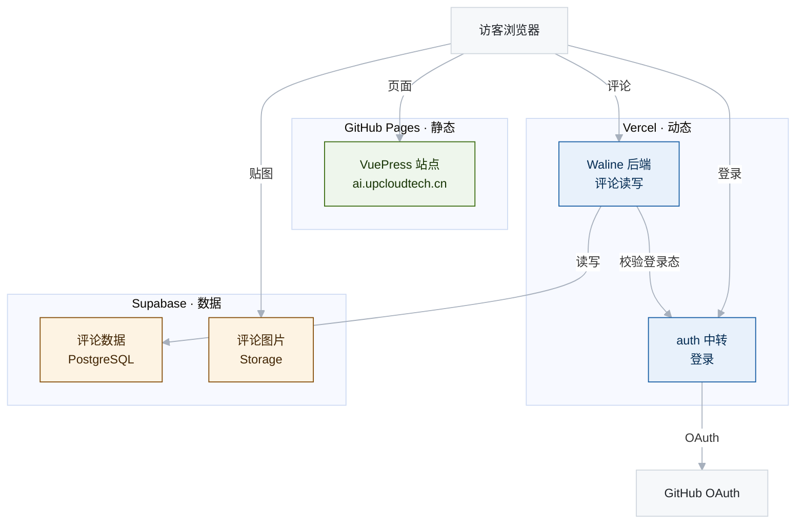

# fengsKB

个人 AI 科技博客。追踪 AI 前沿动态，写长文，也写听歌的感想。

- 站点：<https://ai.upcloudtech.cn>
- 仓库：<https://github.com/shenliliaff/shenliliaff.github.io>
- 技术栈：VuePress 2 + vuepress-theme-hope，GitHub Pages 托管，内容由自动化任务每日产出

---

## 站点组成

| 模块 | 路径 | 说明 |
|---|---|---|
| AI 科技博客 | `/blog/` | 主体。每日 AI 动态长文，按「月 → 周」两级折叠 |
| AI 热点 | `/hot/` | 已回溯官方一手信源的事件榜单，带搜索与分页 |
| 听点东西 | `/music/` | 音乐推荐与听后感，每页一首歌 |
| 笔记 | `/notes/` | AI 动态追踪等技术笔记 |
| 读书笔记 | `/reading/` | 独立的 docsify 子站，支持 mermaid |

首页不堆内容，只做入口。

---

## 架构



三条链路各自独立：

| 链路 | 谁在跑 | 出问题时的表现 |
|---|---|---|
| 页面 | GitHub Pages，纯静态 | 整站打不开 |
| 评论 | Vercel + Supabase | 页面正常，评论区转圈或报错 |
| 音乐 | 腾讯 / Audius 的 iframe | 播放器空白，正文不受影响 |

**为什么评论要外挂**：博客是纯静态的，没有服务端，而读者需要匿名留言、贴图、作者能管理。GitHub Pages 给不了这些。

**为什么是两个 Vercel 项目**：Waline 默认走公共中转 `oauth.lithub.cc`，它固定返回 5 个社交按钮且无法裁剪。自建 `walinejs/auth` 后，登录页只显示你配了凭证的平台——现在只有 GitHub。

---

## 评论系统

### 访客能做什么

- **匿名留言**：填昵称即可，邮箱和网址选填（填邮箱才会在被回复时收到通知）
- **GitHub 登录**：登录后带头像，并且可以删除自己的评论
- **贴图**：点图片按钮，浏览器先把图压成 WebP 再上传，正文里只留一个链接
- **表情**：五套（推特 / B博 / ALUS / 微博 / 贴吧），全部本地托管

### 四个非默认配置

**1. 评论组件被替换了。** `theme-hope` 会把评论配置 JSON.stringify 后注入客户端常量，函数会在序列化时丢失，所以 `imageUploader` 无法从 `theme.ts` 传进去。解法是在 `config.ts` 里用别名把插件内部的组件入口指向 `components/WalineCommentService.ts`：

```ts
alias: {
  "@vuepress/plugin-comment/service": path.resolve(__dirname, "components/WalineCommentService.ts"),
}
```

> 判断别名是否失效：构建产物里出现 `WALINE_LOCALES` 就说明默认组件回来了。升级 theme-hope 大版本后要回归测一次上传。

**2. 评论图片进 Supabase Storage。** 默认行为是把图片转 Base64 塞进正文，一张图吃掉几千字额度。改造后：

- bucket `comment-images`（Public），单文件上限 2 MB
- RLS 只开 insert，匿名只能新增，不能遍历/覆盖/删除
- 前端压缩：长边 1280 → 优先 AVIF，不支持则 WEBP → 目标 ≤150 KB → 超标降到 900px
- 实测：Chrome 的 `canvas.toBlob("image/avif")` 不受支持会静默回落 PNG（反而更大），代码里校验了返回的 MIME

**3. 表情本地托管。** Waline 默认从 unpkg 拉 GIF，国内常超时，表现为表情面板能开、图全裂。五套表情包已放进 `docs/.vuepress/public/vendor/emojis/`，主站和读书笔记站两处都指向本地。

**4. 头像不走 Waline 默认逻辑。**

Waline 的 Vercel 版有个坑：`@waline/vercel/src/service/avatar.js` 里写死了一段模板，头像是**按邮箱和昵称现算**的，从头到尾不读 `wl_users.avatar`。所以：

- 用 GitHub 登录、数据库里头像也对，前台照样显示邮箱算出来的图
- 只要邮箱是 `数字@qq.com`，就永远命中 `https://q1.qlogo.cn/g?b=qq&nk=<QQ号>` 那条分支
- 改数据库、重新登录、清缓存，全都没用——它根本不看那个字段

解法是覆盖环境变量 `GRAVATAR_STR`（Vercel 项目 `waline-blog`），用 GitHub 的**动态头像端点**，而不是写死某张图：

```nunjucks



https://github.com/shenliliaff.png?size=200

https://q1.qlogo.cn/g?b=qq&nk={{nick}}&s=100

https://q1.qlogo.cn/g?b=qq&nk={{mail|replace('@qq.com', '')}}&s=100

https://seccdn.libravatar.org/avatar/{{mail|trim|lower|md5}}

```

关键在 `github.com/<用户名>.png?size=200` 这个地址：它 302 跳转到当前的 `avatars.githubusercontent.com/u/<id>?...`，重定向响应是 `Cache-Control: no-cache`，图片本身只缓存 5 分钟。**以后在 GitHub 换头像，这里最多 5 分钟就跟着变，不需要再改任何配置。**

> 改环境变量后必须 Redeploy 才生效。验证：
> `curl -s "https://waline.upcloudtech.cn/api/comment?path=<页面路径>" | grep -o '"avatar":"[^"]*"'`

### 管理员

- 后台：<https://waline.upcloudtech.cn/ui/>
- 用**邮箱 + 密码**登录，不要用 GitHub（社交登录是 guest 身份）
- 第一个注册的邮箱账号自动成为管理员（`wl_users.type = 'administrator'`）

### 能力边界

| 能力 | 状态 |
|---|---|
| 匿名评论 | ✅ |
| GitHub 登录 | ✅（国内需能访问 github.com）|
| 微信 / 知乎登录 | ❌ Waline 不提供，与主体资质无关 |
| 点赞一人一次 | ❌ 前端计数，与匿名机制矛盾 |
| 邮件通知 | ❌ 未配 SMTP |

---

## 音乐推荐

`/music/` 是独立的一块：不追新歌、不做榜单，每篇只放一首歌，写一点当时的感受。右下角挂一个入口，点开在独立小窗里听。

### 播放器选型

试过好几条路，最后落成「右下角入口 + 小窗播放」：

| 方案 | 结论 |
|---|---|
| **入口 + `window.open` 小窗** | ✅ 采用。480×720 居中小窗打开 QQ 音乐歌曲页，登录与播放都在第一方上下文 |
| 页面内嵌 QQ 音乐外链播放器 | ❌ 66px 能显示歌名，但未登录时点播放无反应，且进度条交互有 bug |
| 页面内嵌完整歌曲页 | ❌ 扫码显示成功，刷新后又变未登录——第三方 cookie 被 Chrome/Safari 拦下 |
| QQ 音乐 / 网易云音频直链 | ❌ 会员曲目匿名请求返回 `purl` 为空，连试听都不给 |
| B 站 iframe | ❌ 能播但有画面，偏离「听歌」的形态 |
| Audius（去中心化音乐） | ⚠️ 保留给英文独立音乐，华语歌几乎没有 |

**为什么不能页面内播放**：QQ 音乐登录靠 `y.qq.com` 的 cookie。本站里的 iframe 属于第三方上下文，浏览器默认不写入也不发送第三方 cookie，所以「扫码成功」之后刷新一下就没了。小窗是独立窗口，cookie 能正常落地。

### 怎么加一首歌

子页面里写一行：

```md
<QQMusicBar songid="231594573" label="出现又离开 · 梁博" />
```

`songid` 是**数字 ID**，不是 `004DiVWg09UKQx` 那种 mid。取法：QQ 音乐网页版打开歌曲 → 分享 → 复制链接，链接里带 `songid=`。

### 已知限制

- **读不到用户名**：跨域拿不到 iframe 里的 DOM，也读不到 `y.qq.com` 的 cookie，QQ 音乐没有对第三方开放「查当前用户」的接口。任何博客都显示不了访客的 QQ 音乐昵称，除非做浏览器插件
- **会员是访客自己的**：播放用访客自己窗口里的登录态，站点不代持账号、不转发 cookie、不共用会员
- **小窗可能被拦截**：浏览器拦截弹窗时会退化为当前页跳转，保证点得开

### 页面结构

| 文件 | 作用 |
|---|---|
| `docs/music/README.md` | 列表页，一篇文章一行 |
| `docs/music/*.md` | 子页面：播放入口 + 听后感正文 |
| `components/QQMusicBar.vue` | 右下角悬浮入口（点击弹小窗）|
| `components/SongPlayer.vue` | Audius 单曲播放器（英文独立音乐备用）|

---

## 本地开发

```bash
pnpm install
pnpm docs:dev      # http://localhost:8080
pnpm docs:build
```

推送到 `main` 后，GitHub Actions 会构建并发布到 `gh-pages` 分支。

> 不要用 `docs:clean-dev`：它会跳过 `prepare-reading` 预脚本，破坏 `/reading/` 与搜索。
> 构建前必须跑 `scripts/prepare-reading.mjs` 和 `scripts/prepare-blog.mjs`，`/blog/` 列表与侧边栏都依赖后者生成的清单。

## 目录结构

```
docs/
├── .vuepress/
│   ├── config.ts            # 站点配置 + 评论组件别名
│   ├── theme.ts             # 主题、评论、搜索
│   ├── navbar.ts / sidebar.ts
│   ├── components/          # HotRanking / BlogPostList / QQMusicBar / SongPlayer …
│   ├── data/                # blog-posts.ts（生成物）、hot-ranking.ts
│   └── public/vendor/       # 本地托管的 mermaid / waline / 表情包
├── blog/                    # 每日 AI 动态文章
├── music/                   # 听点东西
├── hot/                     # AI 热点榜单
├── notes/                   # 技术笔记
└── reading/                 # docsify 独立子站
scripts/                     # prepare-* 预脚本、验证脚本
video/                       # 独立 Remotion 视频工程
```

## 文档索引

| 文档 | 内容 |
|---|---|
| `docs/comment-images.md` | 评论图床的部署细节 |
| `docs/music/README.md` | 音乐页说明 |
| `docs/notes/AI 动态追踪.md` | 追踪的机构与信源清单 |

---

## 产品介绍视频

发布于 [GitHub Releases：fengsKB 产品介绍视频 V2（晓伊配音）](https://github.com/shenliliaff/shenliliaff.github.io/releases/tag/product-video-v2)，可[直接下载 1080p MP4](https://github.com/shenliliaff/shenliliaff.github.io/releases/download/product-video-v2/fengskb-v2.mp4)。视频约 45 秒，含中文合成旁白与字幕。

独立的 [Remotion 视频工程](video/README.md) 还提供[口播脚本](video/SCRIPT.md)、配音、字幕和原创合成配乐，不影响主站构建与发布。
