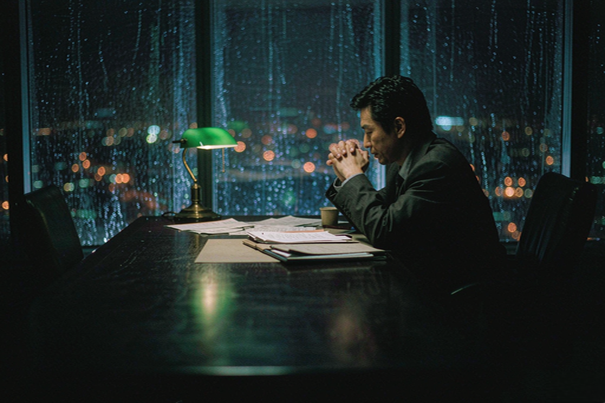

# 最后一次上车的机会，打了三三折

2026-11-01 · 人工智能

10 月 31 日，英国《金融时报》先捅出来的：OpenAI 把最新一轮融资的目标，从 300 亿美元砍到 200 亿左右；估值从 1.4 万亿，退到 1.25 万亿。

砍钱砍了三成三，砍估值砍了一成。

《华尔街日报》当天补了一刀：截至现在拿到的投资承诺大概 110 亿美元，只有新目标的 55%。

《财富》去问 OpenAI，没回。

## 上个月那句话

上个月讲这个故事的时候，说法不是这样的。

当时 OpenAI 把这轮融资包装成「公司明年 IPO 之前，投资者最后一次入场的机会」。理由也硬：7 月以来营收涨得快，估值从 3 月的 8520 亿翻了一倍，奔着 1.4 万亿去。

一个月之后，同一轮融资，同一个故事，价格改了两处。

我不是金融从业者，但我知道一个常识：**一样东西如果贬值了，卖家会说是「市场波动」；如果卖家自己主动降价，那是他怕你不买了。**

## 承诺和到账之间

110 亿这个数，值得单独说。

它不等于 OpenAI 账上多了 110 亿。它是「有人表了态，说我打算投这么多」。真正的钱要等到首轮交割（First Close）才进来，而据知情人士说，因为一部分投资人把自己的额度调小了，首轮交割拿到的钱，会比 200 亿还少。

公司给投资者定的承诺截止日，就是 10 月 30 日，周五。

我老家办事有个礼金簿，红纸黑字，谁来了写谁的名字和数目。簿子记得很整齐，事后对账常常对不上——写一千的最后给五百，写五百的人干脆没来。簿子是给外人看的，钱是给自己花的。

这一轮融资现在处于「簿子写完，钱还没到」的阶段。

## 谁在填这个簿子

按披露，最大的那笔来自一个阿联酋财团，里面有国家支持的科技投资基金 MGX。

这里有个细节我觉得挺妙：作为交易的一部分，OpenAI 还拿到一个选择权，可以租用那一片新建的算力。

也就是说，这轮进来的一部分钱，可能绕个圈又回到卖算力的人手里。到底是投资，还是预付卡，我分不太清。

名单上还有 Founders Fund、Coatue、红杉、安德森·霍洛维茨，以及孙正义的软银。后面还打算开一个口子给个人投资者，价格一样：1.25 万亿。

一个人拿几万块钱，跟 MGX 一个价买入，这在纸面上叫「公平」。

## 为什么忽然就砍了

因为这一周，钱这个东西忽然变贵了。

周四，Alphabet 跌了大约 12%，是它上市以来最差的一天。周五，纳斯达克 100 再跌 3.5%，三周累计跌了一成左右。同一天 Reddit 跌了 29.22%，它成为上市公司以来最惨的一天。

更麻烦的是，所有人都在同一周伸手：马斯克说 SpaceX 完成了 400 亿美元债务融资；Meta 宣布要发 950 亿美元股票；微软发了 250 亿美元债。

一个池子里，四条大汉同时下水。

还有一件更直白的事：今年 6 月谷歌、8 月英特尔、本周一 Meta 各自大额增发，到今天为止，参与认购的人分别浮亏 21%、31% 和 1.6%。买单的人已经亏了钱，下一单自然要还价。

## 标普那份报告

周五晚上，标普把 Meta 的评级展望从「稳定」调成「负面」，评级本身还是 AA-。

报告里的数字我抄一下：标普预计 Meta 今年资本开支 1400 亿美元，2027 年 2250 亿，2028 年 2520 亿。对应的自由经营现金流，今年 -220 亿，明年 -710 亿，后年 -390 亿。

杠杆率：2025 年大约 0.1 倍，2027 年可能破 1.0 倍——而 1.0 倍就是现在这个评级的降级线。

翻译成人话：一家公司今年的自由现金流是负两百多亿，明年负七百多亿，还要继续借钱盖机房，而它靠 AI 赚钱的速度，标普说「看不出什么时候能超过成本」。

Meta 回应说不认同这个判断，说 AI 已经在带来更好的推荐、更高的商业回报。

我看这份报告的时候想到的是另一件事：这已经不是「AI 值多少钱」的问题了，是「借钱盖的房子，什么时候能租出去」的问题。

## 对手在同一个月

还有一层背景，绕不开。

Anthropic 在 10 月 26 日（周一）公开递交了 S-1，计划 11 月在纳斯达克上市，代码 ANT。招股书里写着上半年收入 163 亿美元、经营亏损收窄到 6.93 亿、净亏损 807 亿（主要是可转换票据公允价值变动这类账面数字）。

OpenAI 想赶在它之前把钱锁定。这个动机，路透在 10 月 20 日就报过：两家在抢同一批投资人。

现在的情况是：抢在前面的那家，先把价降了。

## 最后

我不太懂一级市场，说不出这轮融资到底算成功还是失败。200 亿美元还是很大一笔钱，1.25 万亿也还是很大一个数。

我只是觉得有个画面挺有意思：

一个人站在门口卖票，说这是最后一班车了，票不多了。上个月票价 1.4 万亿，这个月改 1.25 万亿，还打了张「个人也能买」的小广告贴在窗口上。

车还没开。买票的人站在月台上，一手攥着票，一手在手机上刷纳斯达克。

我不知道他们心里在想什么。但我猜，多半不是「最后一次机会」，而是「我要是再等等，会不会更便宜」。
