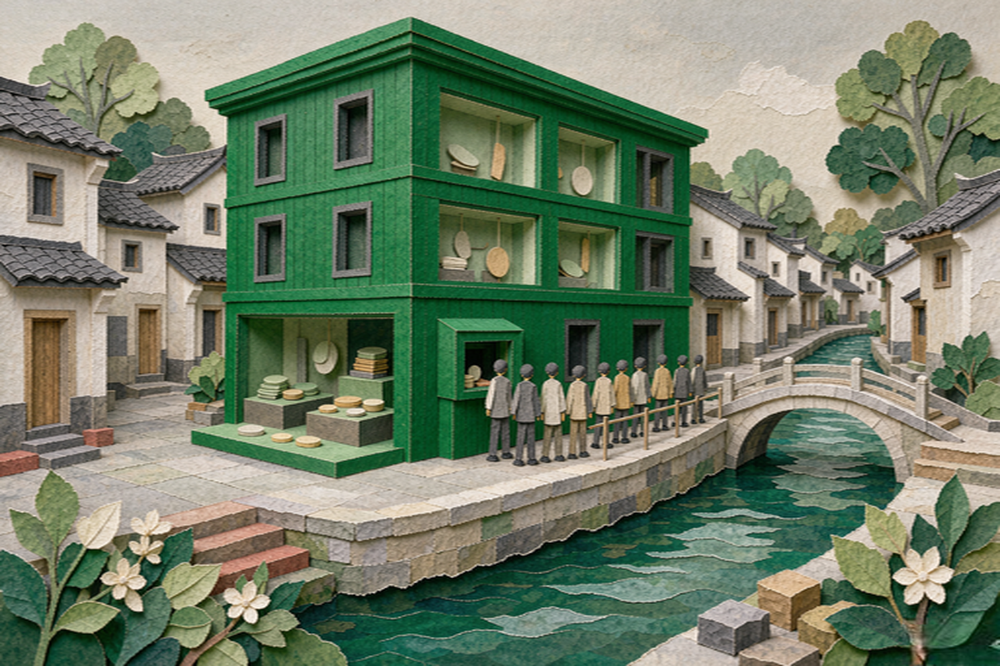

# 给开源盖了个馆，进门二十块

2026-11-01 · 人工智能

11 月 1 日，乌镇，全国第一个"开源主题生态体验馆"开门了。地点在乌镇世界互联网科技馆，一二三层全占满。牵头的是国家网信办和新华社。

我刷到这条消息的时候在便利店排队，手里捏着一瓶水。第一反应不是"厉害"，是去查门票。

查到了。科技馆平日 50 块一个人，峰会期间特惠 20。20 块一票双展，科技馆和开源馆都能看，还免票逛"互联网之光"博览会。

说出来有点怪。开源这件事，最核心的一句承诺就是不要钱。代码挂在 GitHub 上，谁 clone 都行，你不认识我，我也不认识你。现在有人给它修了个房子，装了检票口，票价二十。

我不觉得这是笑话。一个国家肯把"开源"两个字做成一座展馆，说明它已经从极客的爱好变成了基础设施。只是基础设施一般不卖票，水厂和电站也不收参观费。

馆里的布局，官方给了一句话，我念了两遍：

一楼立骨架，二楼展图片，三楼办活动。

像装修公司的方案。但真站进去，这三层楼的顺序是有道理的。

一楼那个展叫"人工智能开源开放重大科技成果展"，分五块：序言、基础设施、创新生态、产业应用、协同治理。浙江这边主推三个东西，本地媒体管它们叫"浙江开源三剑客"——之江实验室的 021 科学基础模型、DeepSeek、千问。

021 我留意了一下。MoE 加 OneTokenizer 的架构，2360 亿参数，已经完整训练完并上线开放。它不看小说不写诗，吃的是图像、序列、光谱这类科学数据。官方说法是"填补了我国在人工智能科学基础模型领域的空白"——这话听着大，但方向确实少见：大家都在做能聊天的模型，做能看光谱的少。

旁边一排：魔搭社区 ModelScope、龙蜥操作系统、玄铁、平头哥、摩尔线程的芯片。从指令集到操作系统到模型权重，一条线摆下来。再往前走是能上手玩的部分——Kimi 和智谱清言的交互屏，蚂蚁的 LingBot 具身智能，群核科技的 Lux3D，还有机器人写书法。

二楼没代码，是新华社的摄影展。历届峰会的照片拼成 64 宫格魔方。

三楼叫"开源会客厅"，开会用的。今年首设"乌镇Talk·开源青年说"，只请 40 岁以下的人讲，11 月 1 日到 5 日五场，每场原本限 100 人。放号当天就满了，主办方临时加名额，负责的人接受采访时说"直呼意外"。

一场关于开源的青年演讲，得靠抢票才进得去。这事儿放在十年前，大概会被当成行为艺术。

我原以为这种馆就是把 PPT 打印出来挂墙上。看完展项清单，改了一半主意。

真正有意思的不是"模型多大"，是"模型在哪用"。

同层还有一个"国家人工智能应用中试基地展"，六个方向：地球科学、时空地理信息、文化旅游、石化化工、医疗、具身智能。数字很土，但很实。

广州的医疗基地，上线 180P 国产化智算资源，发了 84 个医疗健康垂类模型，攒了 154 个高质量数据集，铺开 381 项应用场景，服务超过 1000 家医疗机构。

宁波的石化化工基地，是全国唯一一个石化化工方向的中试基地，发了行业通用模型 1.0，还有一个专门认甲醇制烯烃催化剂图像的智能体。

杭州的文旅基地，"爱优游"超级智能体加"文润"大模型，三年要建 33 个先导应用场景。

这些数字没人会拿去发新闻稿，因为它们不好看。84 个模型里大概有一半只在一个科室里跑。但"中试"这两个字的意思就是这个：从实验室出来，在真地方试过错、定过型，才敢说能用。

开馆仪式上，蚂蚁的倪行军代表企业发言。他给了组数：蚂蚁 2012 年开始做开源，现在开源仓库超过 2000 个，社区核心项目超过 100 个。Ant Design 在 GitHub 累计 9.9 万 star。OceanBase 开源五年，开放核心代码超过 500 万行，集群部署超过 20 万套。LingBot 系列开源九个月，下载量破 220 万。

他还说了一句我记下来的话：希望开源能成为"数字世界的基础公共品"。

公共品这个词用得准。公共品的特点是不排他——路灯不会因为你没交钱就不亮。而一个馆，是有门的。

票的事还没说完。

按科技馆的官方攻略，峰会专属门票不是今天就放，是从 11 月 3 日下午起，在"乌镇峰会观众预约平台"小程序里约。峰会期间，科技馆原来的常规售票渠道暂停。11 月 6 日峰会结束，恢复常态开馆，每周一闭馆。

也就是说，11 月 1 日开馆，普通人最早 11 月 3 日下午才买得到票。头两天是开馆仪式和嘉宾场。

这很正常，所有展馆都这样。我只是觉得，一个纪念"开放"的地方，头两天是关着的。

本届峰会 11 月 2 日到 5 日，主题是"开源开放 共建共享——携手构建网络空间命运共同体"，27 个分论坛。"互联网之光"博览会那边，670 多家企业、1000 多项成果。

我最后想到一个不太正经的问题。

这个馆号称"365 天永不落幕"，意思是峰会散了，馆留着。里面摆的那些模型——021、千问、DeepSeek 这一代——按现在的节奏，大概一年半就得换一次血。三年后走进去，一楼的展柜可能已经是文物。

博物馆的价值是替人记住东西。它的另一面是：被摆进柜子里的东西，通常已经不跑了。

真正的开源还在外面跑。在某个凌晨三点的 issue 里，在某个学生第一次提的 PR 里，在一台没人管的旧服务器上。那些东西不要票，也进不了馆。

我想，哪天这个馆开始办"退役模型展"，那才算真办成了。
