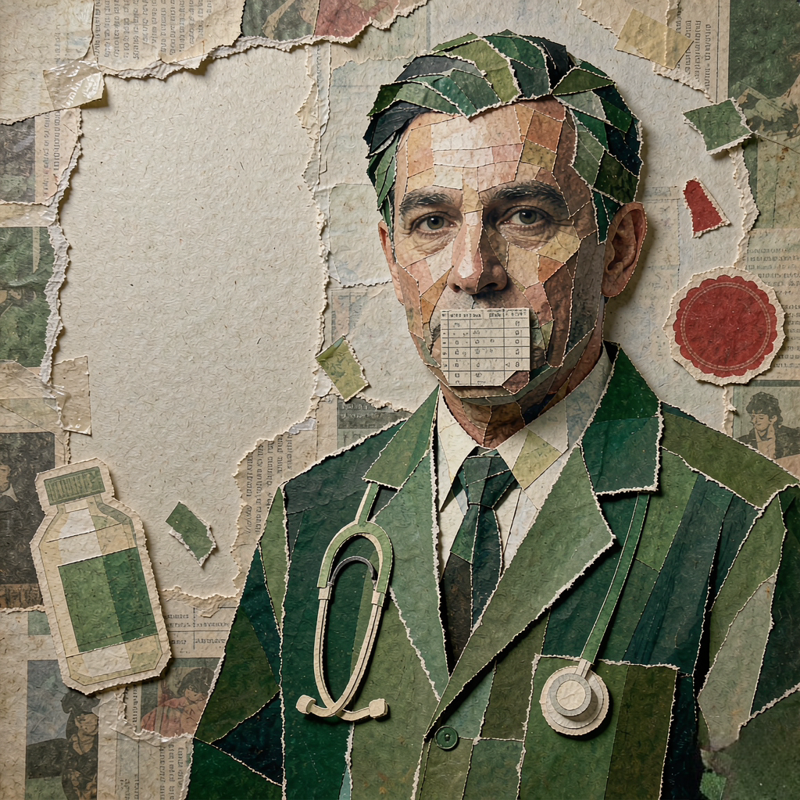

# 让 AI 编一个死亡率

2026-11-06 · 人工智能

11 月 6 日下午四点，中央网信办挂出一份通知。全国范围，为期两个月，整治科普健康类网络谣言。

文件列了四个方向。头两个是老熟人：编健康谣言、冒用专家身份。第四个也眼熟：编康复案例，把老年人往微信群里引。第三个是新来的，一行标题写着「滥用人工智能技术，生成健康科普谣言」。

下面分了四款。

第一款，用 AI 批量生成同质化的文案、图片、音视频，制造虚假热点，推销产品。
第二款，用 AI 换脸、换声，盗用知名专家的形象和声音，做假科普、带货。
第三款，诱导 AI 大模型生成并传播虚假的「死亡率」「存活率」和不实科学数据，借机卖保健品。
第四款，用 AI 生成伪造的权威通报、官方健康提示，或者夸大疗效的图片视频。

第三款我读了三遍。

## 白大褂是怎么来的

先说我姑。她在家庭群里转视频，一天三条。视频里一个穿白大褂的人，坐在诊室背景前，说这三种东西一起吃等于慢性自杀。她信。她连那人叫什么都不知道，只知道"是医生"。

搁两年前，这个白大褂还得是个人。得有人写脚本，有人演，有人剪，一天能出三条算勤快。

现在脸可以是换的，也可以是整张生成的。诊室是画的，白大褂是画的，声音是合成的，连"翻页看下一个"的手都是生成的。一天三百条，每条措辞不太一样，中心思想一样：你得买点什么。

通知里「同质化」三个字，说的就是这个。它不是骂人偷懒，它是在描述产能。

## 一个小数点

然后是那个死亡率。

流程我能猜到大概：某个卖保健品的人，想让手里这瓶东西听起来有出处。他打开一个 AI，问，不治的话会死多少人。

AI 不太爱说自己不知道。它给了一个数字。他截图。截图发到群里，配一句"数据来自权威研究"。

这一款能写进部委文件，是因为它太好用了。AI 说话的语气是确定的。它不说"大概""也许""我不确定"，它说"约为 37.2%"。一个穿白大褂的人在镜头前说这话，你还会掂量掂量；一个不露脸的模型说这话，还带小数点，反而没人怀疑。

小数点是最像科学的东西。

而且这个数字还能反复生成。同一个问题问十遍，能拿到十个小数点。挑一个最吓人的用。

第四款更省事：连出处都不用编，直接把"权威通报"的抬头做出来。红头、公章、落款日期，一套模板。反正群里转发的时候没人会去查那个网址存不存在。

## 「所谓」两个字

第二遍读，我在一处措辞上停住了。

通知写：「打造所谓"国家一级保健师""国家一级营养师"等」。

"所谓"这两个字是文件里的原话。官方文件一般不这么写，它完全可以写"虚假头衔""不实资质"。但它写了"所谓"——等于替你在括号里翻了个白眼：这个头衔不存在，那两个引号是它自己加的。

同一份文件里还有一句更妙的：「不得以账号简介处标注"某医院医师""某领域专家"等形式进行模糊暗示」。

某医院。这三个字原先是真有人写在简介里的。

医院的名字叫"某"，专家的领域叫"某"。你在简介里写"某三甲医院副主任医师"，平台看着像信息，读者看着像身份，实际上一个字都没说。它什么都是，也就什么都不是。

通知这回要求：核验资质，清晰展示，不得模糊暗示，还要严格标注科普信息来源。

顺带说一句，这份文件把话术也抄下来了。"以'科学辟谣''现代医学真相'为名，发表'某类食物全是智商税''肯定致癌'这类极端化论断"，还有"揭露被掩盖的真相""医生不会告诉你的秘方"。

能把这些原话写进红头文件的人，估计自己也刷了不少。

## 用 AI 抓 AI

最耐人寻味的是治理手段本身。

通知给平台提了三条。第一条，查账号、核资质。第二条，管位置——榜单和推荐位不许推这类谣言，建关键词库和典型案例库，辟谣标签、弹窗、私信一起上，把辟谣信息怼到你眼前。

第三条叫「提升平台 AI 防治能力」：督促平台提升对 AI 生成合成涉科普健康谣言信息的发现、识别和处置能力，强化 AI 换脸、换声、虚拟人形象检测和深度合成鉴伪，对假冒专业领域人员的内容实现自动化识别。

用 AI 抓 AI。

造的时候按批造，抓的时候也只能按批抓。人工审不过来，这是算术问题，不是态度问题。

至于抓得住抓不住，我没把握。换脸的技术在往前跑，鉴伪的在后面追，这个距离时宽时窄。文件里用了"提升"两个字，没说提升到多少。

## 两个月

专项行动为期两个月。两个月之后呢。

文件没写。这类文件一般不写。它写"确保取得实效"，写"定期对外发布典型案例"，写"强化警示震慑效应"。

我姑不知道这份通知。她今晚大概还会转一条"这三种食物一起吃等于慢性自杀"。

我们楼下那家药店，每天早上八点在门口发鸡蛋，领鸡蛋的人排到人行道上。发鸡蛋的叫健康讲座，讲课的老师自称"国家一级营养师"，简介上写着"某三甲医院退休专家"。

明天早上八点，鸡蛋还发。
