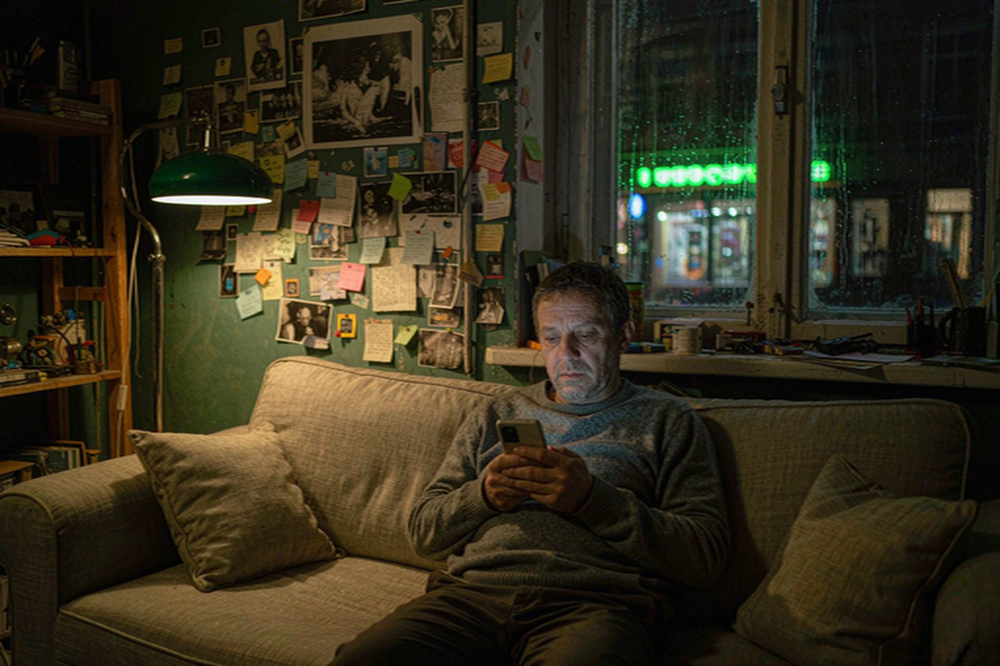

# 它终于记住你了

2026-11-07 · 人工智能

美国时间 11 月 6 日，Meta 研究博客发了篇不长的文章，标题叫《把专用模型带给 Muse 和 Meta AI》。

先说它不是什么：旗舰模型 Muse Wonder 没有对所有人开放。十月那套 Wonder 仍然是付费墙后面的东西，跑在 Meta 的模型接口和 Muse Code 上。

这次是把 Wonder 当老师，教出一批「专用版本」，塞进 Muse 和 Meta AI 里现成的模型。蒸馏这个词不好听，但意思是对的：大师傅不亲自下厨，先把手艺教给徒弟，徒弟去应付每天几百万人点的那碗面。

教过去的是两个本事。

一个叫 Active Memory，主动记忆。要做三件事：分清哪些信息是临时的、哪些是永久的；跨时间推理；分辨哪些细节还有效、哪些已经过时了。

另一个叫 Active Focus，主动专注。管的是任务卡住的时候别撂挑子——拿真实世界里那些坑训练它，卡住了再试一次、绕过去、或者换条路。

## 三个数字，都是自己出的卷子

官方给的数字是三个。

Muse 里忘掉关键信息的比例，降低了 2.4 倍。
一项叫 Active Memory 的评测，正确用上关键上下文的比例从 76% 提到 90%。
Muse 里「遇到意外问题的日常任务」，完成率提升 67%。
另外还有一个内部指数，叫 Personal Superintelligence Index，这一代 Muse 拿了 47%，上一代 38%。

我盯着这四行看了一会儿，然后想起一件事：这四组数字，全部来自 Meta 自己的评测。

没有第三方复现。67% 那个提升，没给基线完成率——你不知道它从 20% 提到 33%，还是从 60% 提到 100%。Meta AI 那一侧，一个数字都没有，只有形容词：更能把复杂问题拆成步骤、追问更准、你跟它换方向的时候它跟得上。

文里也没写模型 ID、参数量、哪些地区先上、什么时候上。写的是「rollout to people who use Muse and Meta AI」，翻译成中文是「推送给使用 Muse 和 Meta AI 的人」，听起来像全网，实际范围没人知道。

同一天 Meta 还上了个叫 Muse Spaces 的东西：你一句话描述想要什么，它给你搭一个小面板，钉在侧边栏。扎克伯格在 X 上确认了这次推送，顺口提了一句 Muse 在北美装机已经过了一千万。

## 忘不掉，和记得住，是两件事

我用过好几个助手，最烦的不是它答错，是每次开新对话都要重新自我介绍一遍。

我在一家做汽车零部件的公司上班。这句话我说过大概两百次。每次说完，对面那位都礼貌地点点头，然后继续把我当成一个不需要上下文的搜索引擎。

所以「记性变好」这件事，听起来是好消息。

但仔细想想，AI 记不住的原因，从来不是硬盘不够。

上下文越长越贵，每一轮对话里塞进去的每一个字都要付钱。存下来的东西还要有人负责检索——你三个月前提过一句牙疼，今天问它报销流程，它该不该把牙疼翻出来？翻错了是打扰，不翻是失职。这中间没有标准答案，只有判断。

而判断「什么该忘」，比判断「什么该记」难得多。

人会忘。这不是缺陷，是省电模式。我记不住上周三中午吃了什么，也不打算记。但如果我吃过一次亏——比如某家店的鱼不新鲜——这件事会自己黏在脑子里，二十年后还在。人的遗忘是有选择的，选择的标准叫「疼过」。

机器的遗忘没有疼过。它只能被人告诉：这条重要，那条不重要。

Meta 现在给出的答案是三个自家指标，和一个 47 分的内部指数。也就是说，「什么算重要」这件事，最后由一个自己出题、自己判卷的分数说了算。

## 楼下那家馆子

我家楼下有家小馆子，老板娘五十来岁。我第一次去说不要香菜，第二次去她就不问了，第三次去她已经把这事写在了点菜单上，用圆珠笔，字很小。

她记住的不是「这个客人不吃香菜」这一条数据。她记住的是：这个人会在意这种事，所以以后所有跟香菜有关的东西都得留个心眼。这是两回事，后者才是本事。

Meta 这次想做的，恰好是后者——不是记住你说过什么，而是判断你说过的话里哪一句以后还有用。

这个方向是对的。我只是不太确定，一个 47 分的内部指数，够不够当那个判断标准。

夜里十一点，客厅只开着台灯。你随口跟它说了一句，下个月要去看牙。

第二天它没提。第三天它问你，要不要把周四下午空出来。

你心里会舒服一下，然后凉一下——它记住的东西，比你预想的多。
