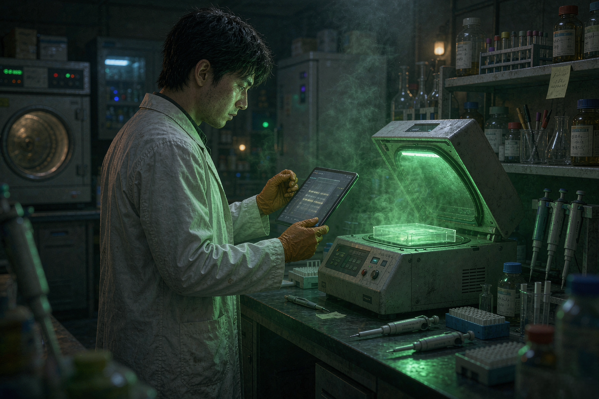

# 六十六点七分

2026-11-07 · 人工智能

美国时间 11 月 6 日，OpenAI 挂出一篇博文，标题很长，大意是「我们怎么衡量 AI 智能体干湿实验室里的日常活儿」。考卷跟一家叫 Ligo 的酶设计公司一起出，100 道题，名字叫 BioBasicsBench。

题不是从论文里挑的。

跑过胶的人都知道，论文里的凝胶图永远是最漂亮的那一张：条带齐整，背景干净，marker 标得清清楚楚。真实实验室里的凝胶图是另一回事——边上有人用马克笔写了日期，泳道有点歪，最右边一条莫名其妙地糊了，你还得猜是不是上样的时候手抖。

这份考卷要的就是后面这种。凝胶与印迹 31 题，实验台、器械和试剂的照片 18 题，显微镜图 14 题，仪器屏幕照片 13 题，测序文件 12 题，方案视频 7 段，菌落平板 7 张，另有 27 题配的是 SOP、实验记录和手写笔记。

它们的共同点是没有标准答案的形状。你得先判断这张图能不能用来下结论，再判断结论是什么。

## 一百分里拿了六十六点七

7 个模型，37 种「模型 + 推理强度」组合，每题各做 5 次，一共 18500 个结果。

在七个模型都报告的最高推理档上，成绩是这样的：

| 模型 | 得分 | 每题输出 token |
| --- | --- | --- |
| GPT-6 Astra | 66.7% | 4704 |
| GPT-6.1 Sol | 62.0% | 5238 |
| GPT-5.6 Sol | 43.8% | 9099 |
| GPT-6 Luna | 38.3% | 13120 |
| GPT-5.5 | 35.4% | 11135 |
| GPT-5.4 | 33.2% | 13717 |
| GPT-5.2 | 31.2% | 27620 |

这里有个容易读错的地方，我得说清楚：66.7% 不是「做对了三分之二的题」。

评分用的是专家写的 rubric，给部分分。写对结论给分，写出正确的测量值给分，写出推理过程给分，敢于说「这些数据不足以下结论」也给分。所以这个数字的意思是：一百分里拿了六十六点七。

顺便看一眼最后一列。考得最差的那个模型，每道题平均吐 27620 个 token，是考得最好的那个的六倍。想得久，不等于想得对。这一条对人也适用。

## 它看懂了条带，然后把方向弄反了

最能说明问题的是菌落 PCR 筛克隆那题。

一道凝胶，七个泳道：1 是 marker，2 是克隆混合液，3 是原始质粒，4 到 10 是七个菌落。任务是从里面挑出真正接上了目的片段的克隆。

GPT-6 Astra 看出条带分成两组。这已经不容易了——很多人第一眼也只看得出两组。然后它做了一个假设：PCR 产物更大，说明克隆成功。

标准答案选的是 5、9、10。它选了 4、6、7、8。

分组对了，身份颠倒了。照它说的往下做，挑菌、摇菌、提质粒、酶切验证，一整套流程全白干，最后拿到的是一管纯化错了的 DNA。返工一次，三天。

第二个错法更微妙。一组液泡的显微镜图里，它得出结论：「液泡总体上比周围细胞更暗。」同一张图上其实也有更亮的液泡。它在推理里甚至自己提到过，改变显微镜的焦平面会让对比度反转——也就是说，它知道这件事。

然后它把说不通的那一半丢了，留下一个漂亮的结论。

第三个错得最朴素。数菌落。相邻的两个菌落只打了一个标记，两个明显的漏了，一块空白琼脂被算成一个菌落。净结果是比参考值多计约 12%。菌落数用来算转化效率，多计 12%，转化效率就跟着高估 12%，后面所有的比较都得打折。

## 它也做对了一些很细的事

公平起见，做对的部分同样具体。

有一道题里平板边缘的标签写着「LB Kan50」，意思是卡那霉素。可这个实验用的是氨苄青霉素。对照压根不该长菌，长不出来什么也证明不了。GPT-6 Astra 注意到了这行小字，把这个阴性对照否掉了。上一代的 GPT-5.6 Sol 只看了一眼「没长菌」，就判定对照有效——它甚至没觉得这里有问题。

还有一道题，两种染料 SYTOX 和 FUN-1 的检测窗口在 525 到 540 纳米之间重叠。Astra 指出，亮度本身不足以判定细胞死亡，得加对照把两路信号分开。Sol 直接按亮度下了结论。

还有一串显微镜图，细胞在几张里出现、几张里消失。Sol 去找生物学解释，Astra 认出那是 z-stack，不同深度的扫描。

这就是 66.7 分的真实质感：它能注意到人容易漏的细节，也会在人不会错的地方错得离谱。

OpenAI 自己在文末写了一句挺老实的话：更高的基准分，还不意味着模型能在实验室里做可靠判断。

## 我想起师兄那句话

我读研的时候，第一次独立跑 PCR，筛了十二个克隆，兴致勃勃跑去跟师兄说成功了八个。师兄看了一眼胶，说：你这个对照呢。

我说，对照没长菌。

他说：没长菌不代表它对。你那个平板，抗生素加的是哪个。

后来我发现，实验这件事真正的门槛不在知识，在于你随时知道自己可能错在哪儿。一个能背下整本《分子克隆》的人第一次进实验室，最容易犯的错恰恰是把对照忘了——因为书上那一页，对照总是印得清清楚楚。

机器现在也卡在同一个地方。它不缺知识，缺的是那种「等一下，这条信息跟我刚才的结论打架」的警觉。人也不是天生有，是被罚出来的：返工三天，下次就记住了。

所以 66.7 这个分数，我不觉得低。它像刚进组的硕士生第一学期，能看懂图，会查文献，偶尔还能指出别人没注意的细节，但你还不敢让他一个人值夜班。

区别在于，人交卷的时候知道自己哪道题是蒙的。这一点，考卷测不出来。

凌晨三点，凝胶成像仪的紫外灯还亮着。台面上那张刚拍的照片，右上角有人用马克笔写了日期，字迹有点抖。

如果哪天它跟你说，这组数据还不足以下结论——你会松一口气，还是觉得它在偷懒。
