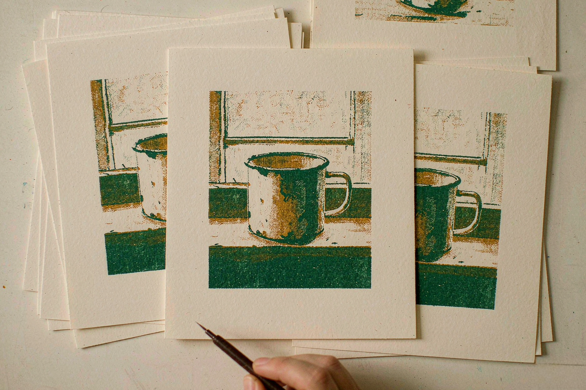

# 你只改了袖子，墙自己动了

2026-11-09 · 人工智能

我每天给这个博客配一张图。图是模型出的，提示词是我写的，配了几个月，我给自己立了条规矩：图上不许出现文字。

不是审美洁癖。是它写不对。中文小字尤其，笔画一密就糊成一坨，远看像字，近看是麻。所以我干脆在规范里写死「no text」，标题交给网页自己排。

还有一条更烦的：改图。你把模特身上的外套从灰改成蓝，背景那面白墙会悄悄变成米色。你再换个包，脸开始发光，皮肤像抹了一层油。改到第三轮，画面已经不是原来那张了。你不知道是哪一步弄丢的，也没法退回去，只能重开一把——重新写提示词，等四张，挑一张。

做图这件事，这两年一直是这样。不是画画，是抽卡。

11 月 9 日，字节跳动 Seed 团队发了 Seedream 5.5，主要就是冲着这件事来的。

官方给的演示是同一个人，连着改 100 轮，每一轮都把上一轮的结果当输入。中间换衣服、换配饰、挪桌上的东西。到第 100 轮，它还能单独去修戒指、修镜框，配饰压在皮肤上的接触、遮挡、光影都对得上。官方管这叫「非编辑区域的像素级保持」，火山引擎那篇稿子写得更狠一点：编辑区域精准变动，非编辑区域误差归零（ΔRGB = 0）。

我不太信「归零」。但「100 轮」这个数我信一半，因为真正让人崩溃的从来不是第 1 轮，是第 7 轮之后那种说不清的糊。

文字也动了。官方给的两个数是：严重文字崩坏率 0.4%，轻微崩坏率 1.7%。翻成人话，一千张里大约四张会把字写坏，十七张会写歪一点。它没写上一代是多少，这个留白我记住了。

评测在 MagicArena 上做，六类场景——电商、营销、影视、游戏、办公、服装设计。官方说可用率都涨了，影视和办公翻了一倍以上；真实感那项，图生图的 GSB 是 +55.62%。GSB 就是让专家两张两张地比，「这张好、那张差、差不多」，+55.62% 是专家的偏好差值，不是你的商品图能不能用。官方自己也点了对手的名字：GPT Image 2.5 Sunburst、Nano Banana 2.1。

价格是这次最实在的部分。2K 方图改一张，0.28 元，比 Seedream 5.0 Pro 便宜 60%，速度快了近 40%。计费还是「输入图 + 输出图」两段，文本 Token 不收钱。

两毛八是什么概念？差不多一张彩打的钱。以前改十版，每版抽四张，四十张里挑一张——钱不算多，但那种「再点一次说不定就好了」的心气很耗人。现在官方卖的是另一套：别抽了，一笔一笔改，改一百笔。

还有一个能力，做电商的人会先叫好：原生 RGBA 透明素材。出来的图自带 Alpha 通道，也就是轮廓已经剪好，不用抠，不用修边。火山引擎那边说最多支持 100 层分层输出。做 2.5D 小动效、把商品塞进另一个场景、把人物贴到海报上，这些原来最脏最烦的活，工序一下少了一截。

今天能上手的是 C 端：即梦网页版的画布、豆包 App 和网页版的图像生成、豆包工作里的技能，都能在模型列表里选到 5.5。开发者要等——API 本周才上火山方舟。官方还留了一句，5.5 之后有 Pro 版。

于是就有点尴尬：它宣称解决了「越改越糊」，而你要真拿它去跑一条生产管线，还得等；今天能用的，是给人手点的那几个入口。

我今晚还得给文章配图。那条「no text」的规矩，我打算先留着。不是因为 0.4% 不可信，是因为落到一张海报上，那 0.4% 恰好可能是标题里的那个字——而标题只有一行。

不过这回我想把提示词写长一点，具体到「窗台上有一只掉了漆的搪瓷杯」这种程度。改到第九遍的时候，我想看看那只杯子还在不在原来的位置。
