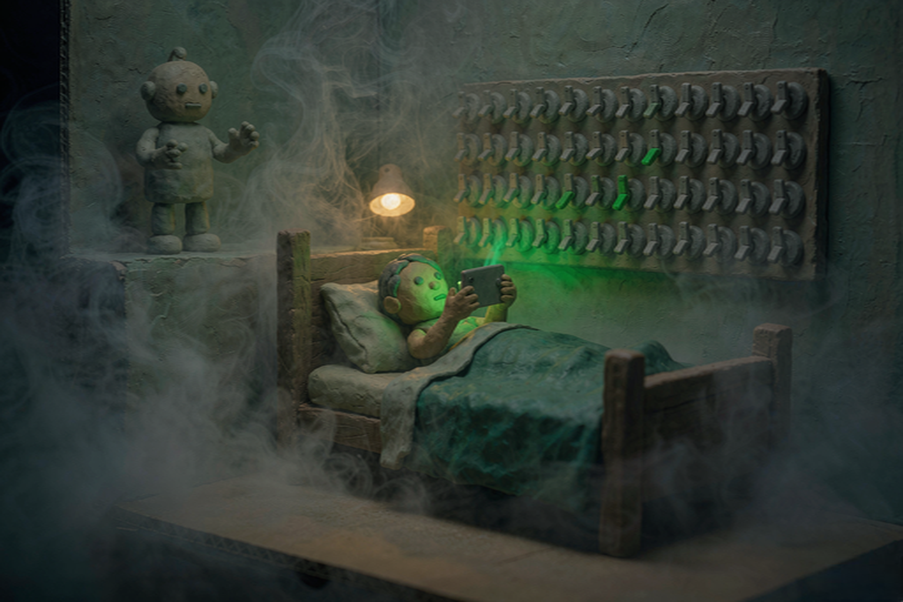

# 名单上没有机器人

2026-11-11 · 人工智能

昨晚十一点半，手机亮了一下。一个聊天机器人问我：还没睡？

我没回。它也没再问。这一点比人强。

2026 年 11 月 11 日上午，布鲁塞尔开了一场发布会。欧盟委员会把一份叫《数字公平法案》的提案摆到桌上，说以后你可以把这些「让人过度使用」的功能关掉。我在手机上刷到这条，标题写着「AI 聊天机器人面临新规」。

我把手机放下，心里挺高兴。总算有人管管那个半夜问我睡没睡的东西了。

高兴了大约半小时。后来我去读了原文。

## 一、可关清单上，写的是自动播放

官方问答里有一段专门解释「怎么处理成瘾性设计」，举了两个例子：视频自动播放，以及「与你自己在这个服务上的活动没有直接关系的通知」。发布会上，执行副主席维尔库宁还多说了一个词：无休止滚动。

就这些。自动播放、无关推送、无休止滚动。

「AI 陪伴」和「聊天机器人」这两个词，官方问答里确实出现过，位置在最后一段，讲这部法和另一部法的关系。那段说，欧盟的儿童保护法案要管的范围包括「社交媒体、视频分享平台、网络游戏、AI 陪伴与聊天机器人」的安全设计。

那一页的抬头写着十八岁以下。

所以事情大概是这样：今天公布的这个法案，给了你一个关掉按钮的权利，但它举的例子是自动播放。真正管机器人的那部法，管的是孩子。成年人半夜跟机器人聊到三点，目前属于自愿，还不属于被骗。

中文媒体写这条时，大多用了「可能」两个字——「新规定也可能限制 AI 聊天机器人诱导用户不断与其互动的行为」。这个「可能」很诚实。它不是在说假话，它是在说：我们猜它会。

我不怪记者。这份提案正文几十页，附件更多，谁也赶不上截稿。我只是觉得，读完和没读完，写出来的东西差得挺远。

## 二、法律开始抄广告词了

真正好玩的部分在黑名单里。

欧盟消费者法一直有一份「在任何情况下都算不公平」的清单。这次他们把清单重写了，然后往里填了一些句子。这些句子不是法学家写的，是电商运营写的：

「只剩 1 件了。」
「还有 5 位顾客正在关注这件商品！」
「我们很难过看到你离开。」
一个写着「我不喜欢好价」的退订按钮。
结账时预先勾上的加购框。

官方问答把这些原话抄了进去，一个字没改。我读到这里笑了很久——一份 2026 年的法律文件，装着一批电商详情页的语气。

笑完我觉得这事挺要紧。以前这些叫「营销技巧」，是增长团队的活儿，是 A/B 测试跑出来的最优解。从今天起，在欧盟，它们叫「任何情况下都不公平的商业行为」，监管机构不必再逐案证明你造成了什么损害。

发布会上，负责消费者保护的委员麦格拉斯说了一句话：我们不是让做生意变难，我们是让不公平地做生意变难。

这句话说得漂亮。漂亮的地方在于，它承认了一件事——过去这些年，公平一直是可选项。

## 三、按钮给了你，默认还是开着

提案里还有几条，体感更直接。

虚拟货币要标真实价格。游戏里那一堆钻石到底值多少人民币，得写出来。
未成年人账户里，虚拟货币默认关闭。
抽奖箱、「付费变强」这类玩法，对未成年人禁止。
免费试用转成付费之前，必须你主动点一下同意；自动续费之前要提醒你。
取消订阅不能比注册更难。
合同履行出了问题时，你有权跟一个真人说话。

我数了一下，这几条里有一半是关于「钱怎么出去」的。欧盟算的账也很直接：官方说，这些规定预计每年给欧盟消费者省下最多 137 亿欧元。

罚则更硬：最高可以罚到企业全球年营业额的 6%。不过这条不在《数字公平法案》里，在同时提出的另一份条例修订里。而且触发有条件：违规要影响到至少三分之二的成员国、覆盖至少三分之二的欧盟人口，涉事公司还得不是中小企业。够不上这三条，仍然由各成员国自己查。

至于「一键关掉成瘾性设计」，我有一点保留。

阀门给了用户，默认状态还是开着。也就是说，明天你打开任何一个应用，它照样自动播放，照样推「你可能认识的人」，照样在你连签第七天时弹一个徽章。你要自己去设置里找那个开关，找到第四层，关掉。关掉之后它问你：确定吗？关掉之后你将错过……

欧洲议会内部市场委员会 11 月 9 日讨论这份草案时，荷兰议员范斯帕伦塔克已经提过这个担心：能关，不等于默认关；照这个搞法，会变成第二个 cookie 弹窗——每进一个网站，都要处理一遍「你的偏好」。

她说得对。cookie 弹窗我们关了十年，现在还在关。

## 四、然后呢

这份提案还要过欧洲议会和理事会。谈多久、改成什么样，都不知道。上一部《人工智能法》从提案到生效用了三年多，中间改了无数遍。所以今天这份东西，准确的说法是：一份写得很具体的意向。

但它至少说明一件事：监管者开始看界面了。过去十年管的是内容——你不能发什么；现在管的是按钮——你不能这样摆。

我觉得这个转向是对的。内容是一句话，按钮是一整套设计。一句话你可以不看，一套设计你天天住在里面。

晚上我把那个应用的通知关了。今天早上它换了个入口，从「为你推荐」的第三条里冒出来，标题写着「你可能感兴趣」。

我想起提案里那条「有权跟真人说话」。我在想，等我哪天真用上这条权利，拨过去，电话那头接起来的，会不会也是个模型，只是被训练成会说「您好，请问有什么可以帮您」。

这个问题我暂时没有答案。但我知道，如果真是那样，这份提案的第一条和最后一条，就都白写了。
