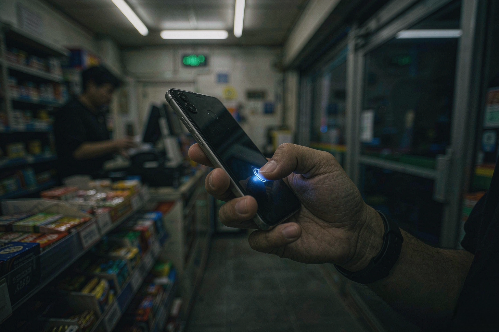

# 每一笔都要你按一次指纹

2026-11-14 · 人工智能

我小时候替我妈去菜市场买肉，手里攥着钱，摊主总要问一句：你妈知道吗。

二十多年过去，掏钱的人换成了一个叫 dot 的智能体，摊主换成了 Visa，那句话还在，只是换了个形式——你得按一次指纹。

北京时间 11 月 13 日晚上，OpenAI 挂出一篇博客，标题朴素得很：Introducing ChatGPT Wallet。dot 是它家那个一直挂在线上的智能体，现在可以替你找东西、替你结账了。

前提是每一笔都得过你这一关：先核对商户、商品、数量、总额、扣哪张卡，再按 Face ID 或者指纹。按了才算数，按完会留一条记录，说明这笔是真人批的。

先把它不是什么说清楚。不是银行账户，不储值，不放贷。上线初期也不从交易里抽一分钱。这几句官方都写在明面上。

门槛也写得直白：只在 dot 的对话里能用，普通 ChatGPT 对话不行，Work 不行，独立 Codex 也不行；虚拟信用卡暂时加不进去；首批只给美国 18 岁以上的 Pro 订阅用户，卡还得是美国发的。

技术上它解决的是一个老问题：怎么让一个你看不见的东西替你花钱，又别让它看见你的卡号。

做法是令牌。你绑一次卡，之后每笔交易，卡组织单独发一张一次性卡号，连安全码和有效期都是这笔专用的。dot 拿着这张，商家也只看这张。钱仍然从你那张真卡上扣，积分照算，出了纠纷照打。

这不像把家门钥匙交给保姆，更像每次出门前给她配一把只能开一次的钥匙，用完作废。

设计挺周到。周到到我读完第一遍，觉得没什么可挑剔的。

然后我看到了亚马逊那一行。

问题不在门里，在门外。

亚马逊把 AI 智能体挡在自己的站点外，把人往自家 Alexa 那边引。美联航 11 月 11 日说，会阻止智能体代订机票。达美也一样。理由不难猜：一个不看广告、不比价、报个需求就直奔收银台的东西，对零售商来说不太像客人。

所以 OpenAI 同一批发了两样东西：一个钱包，和一份给商户的《Commerce Partner Playbook》。后者教网站怎么用 Web Bot Auth 认出签名过的智能体请求、别把正常流量当成攻击拦掉，还列了一串正在对接的反欺诈公司（Forter、Riskified、Sardine、Signifyd）和支付服务商（Adyen、Checkout.com、Stripe）。

一个做模型的，发新品当天得顺手给全世界的网站写一份说明书，请人家把门开一条缝。这大概是这门生意现在最真实的样子。

至于以后，博客里写得很轻：用户可以设消费限额、限定买哪类东西、哪个时间段，授权之后让 dot 自己下单。

这句话读起来像便利，实际上是把"按指纹"这个动作往后挪——挪到你不再看每一笔的那一天。到那天，出问题的不是技术，是习惯。

官方自己也留了台阶，说代理购物还在"早期"。这话没错。比特币早期也没人拿它买咖啡。

我妈现在还是自己去菜市场，扫码付钱，付完要盯着屏幕看一眼数字。我问她干嘛不干脆开个免密，她说：看一遍心里踏实。

按指纹这个动作，大概就是数字世界版本的"看一遍"。

它什么时候会消失，我说不准。我只知道它消失的那天不会有人发通知，就像现在也没人记得，上一次认真核对账单是哪一年。
