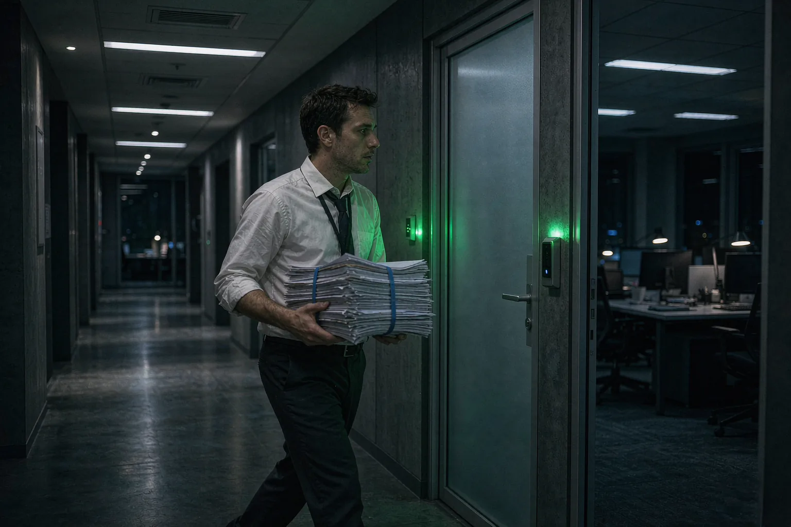

# 他们自己办了本杂志

2026-11-16 · 人工智能

11 月 15 日，OpenAI 官网上多了一个栏目，叫科学博客。

开张第一篇的标题是《我们的新科学博客》。开门第一天，先挂一块牌子说明自己是干什么的，这很像小区门口新开的那家店，玻璃上贴着"本店今日开业，主营早点"，店里其实还空着。

第二篇就实在了：《朝着格点上的标准模型走了一步》。

## 先说这个博客打算干什么

官方说法是三类内容。一类是研究与发现，自家的、合作方的、外面科学界的。一类是方法和实用指南——怎么用模型做科学计算、翻文献、做数据分析、排实验，还有一句我觉得挺难得：会讲这些方法哪里靠不住。

第三类是科学界自己的声音，第一手经验，以及一些没答案的问题。

这三类里，第一类最容易变成宣传，第二类最容易变成教程，第三类最容易变成客套。真正的分量在最后那句"哪里靠不住"上——一家卖铲子的公司愿意在自家网站上写铲子哪里不好使，这事本身值得记一笔。

## 但真正变的是发表权

10 月里有一天，OpenAI 一口气放出 700 多篇 AI 写出来的数学手稿。数学家给这事起了个名字，叫 slop drop，翻过来大概是"倒垃圾"。

一堆没人来得及看的证明，一下子堆在仓库里。这么做的问题是：它不是发表，是倾倒。

于是有了后面这一套。OpenAI 请了 2004 年诺贝尔物理学奖得主 David Gross 牵头，组了个五人小组，内部叫"护送委员会"。东西先给他们，审完再放。

10 月 28 日，杨-米尔斯那一份的 Lean 代码交到五人手里。11 月 10 日夜里，五个人在 GitHub 上把代码和评审文件一起放了出来。

结论是：按物理和数学界通行的题面，这份证明把纯杨-米尔斯理论"造"出来了。没做出来的部分，文件里也写清楚了——质量间隙没证出来，无穷大体积下极限是不是唯一，也没证出来。

克雷研究院那 100 万美元，还挂在墙上。

## 阅卷的人也在用 AI

评审文件的开头有两句话，我看了半天。

大意是：我们用 OpenAI 的 Astra 帮着消化它交上来的 Lean 代码；我们还不敢说完全看懂了这个证明。

翻到末尾致谢，又有一句：这份文件请 Anthropic 的 Fable 提过意见。

五位顶尖的物理学家和数学家坐在一起阅卷，读代码靠 OpenAI 自己的模型，改文件请对手家的模型提意见。出题的人也在这个组里——Arthur Jaffe，当年杨-米尔斯那道千禧难题的官方题面就是他和 Witten 写的。出题的人亲自来阅卷，读卷子还得借考生的眼睛。

我不知道该怎么评价这个画面。它不像丑闻，也不像突破。它更像一个单位新上了系统，结果所有人都在问 IT 怎么用。

## 那篇"格点上的标准模型"

第二篇文章讲的事，说白了是个几十年的老麻烦。

物理学家算粒子，习惯把时空切成一张格子，然后在格子上算。这办法叫格点规范理论，1974 年就有了，算强相互作用算得极准，准到能跟对撞机数据对上小数点后好几位。

但要把整个标准模型搬上格子，一直办不成。卡住的地方是手征费米子——标准模型里的费米子左右手待遇不一样，而格子上有条定理（Nielsen–Ninomiya）说，你想在格子上同时保住手征对称和局域性，办不到。几十年里大家绕着走：domain wall、overlap、Ginsparg–Wilson 关系，一层一层打补丁。

所以"非微扰地定义标准模型"不是一道算术题，是要给一套理论在地基上重新浇一遍混凝土。

OpenAI 的说法是，GPT-6 Astra 帮忙把一个想法推成了一份详细证明。

官方给的摘要只有这一句。正文我没读到——公告页上就这一行字，链接点进去也只有这一行字。这大概就是这个博客现阶段的水平：牌子挂出来了，菜还在后厨。

## 我为什么在意这件事

不是因为 AI 会做物理了。是因为发表的规矩变了。

以前一套流程是这样的：投稿、审稿、修改、接收、排期、见刊。慢，慢得让人骂街，但慢有慢的好处——中间隔着一群跟你没关系的人，他们不认识你，也不靠你吃饭，他们的意见会被记下来，哪怕最后被驳。

现在这套流程被压缩成了一个域名。审稿人自己请，发布日自己定，作者栏写模型的名字。

这不是造假。恰恰相反，那个五人小组干得挺认真，连"我们看不懂"都写进文件里了。但这仍然是一家公司在自己院子里立了块布告栏，然后把布告栏叫作学报。

## 楼下

我下楼买烟，打印店老板正在给一摞纸装订，蓝色封皮，是他儿子的毕业论文。

他问我，现在论文是不是都不用印了。

我说有些是不用了。

他说那怎么算数呢，总得有人签字吧。

我说签了，签的是模型的名字。

他抬头看我一眼，说那奖金谁领。

我说没人领，一百万美金还挂着呢。

他低头继续压封皮，压了半天，说了一句：那不还是没人认。

我站在门口抽完那根烟。玻璃上贴着他自己打印的价目表，A4 黑白两毛，彩印一块。风一吹，纸角翘起来一点。

我想的是另一件事：一百万美元摆在那儿，谁都够得着，可它要求领奖的必须是一个人。
