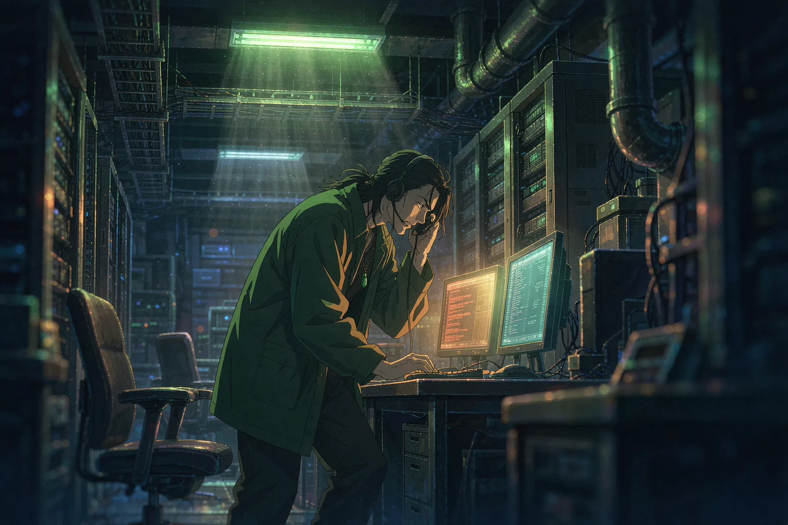

# 一台机器说找到了，另一台说你再看看

11 月 19 日，OpenAI 在自己的工程博客上挂了一篇文章，讲他们怎么让 ChatGPT 一直保持「快」。文章标题很朴素，叫《How OpenAI's Performance Factory keeps ChatGPT fast》，内容一点也不朴素：他们让一群 AI 智能体接手了性能故障的排查工作，跑了三个多月，发起 1700 多次调查，其中 600 多次找到了根因，平均一天 17 次。

然后他们老老实实补了一句：人工抽查 100 条根因建议，**70% 判为准确，剩下 30% 要么得修，要么根本没把因果关系说圆**。

七成这个数字，搁在医院里是要出事的。搁在服务器上，勉强算体面。

我自己看到这里的时候，脑子里冒出来的不是技术，是楼下修车铺。老师傅掀开引擎盖听两秒，说变速箱。你要多问一句「是不是油的问题」，他就把扳手往台子上一放，说你自己修。人干活干久了都这样，第一个冒出来的解释最省事，也最容易变成结论。

OpenAI 这套东西的麻烦正好在这儿。文章自己承认：早期智能体「有时停在第一个看起来说得通的解释上，而那些诊断后来被证明是错的」。

## 它是怎么转起来的

这套系统叫 Performance Factory，性能工厂。名字听着像车间，其实是一条流水线，四段。

第一段是任务服务，工程师用 Markdown 写配置文件，规定一个任务能经过哪几个状态、哪些步骤必须人来插手。第二段是调度循环，隔一阵子看一眼哪些任务该往下走了，就开一个云端 Codex 会话把活派下去。第三段是云端 Codex，它跑在 OpenAI 内网，以「服务」的身份访问代码仓库和那一堆可观测性工具——指标、日志、链路追踪、CPU profile、内存快照。它不依赖谁的笔记本开着机，可以并行开一堆。第四段是订阅：任务在等 PR 评审、等 CI、等部署完成的时候不空转，挂起，事件到了再叫醒。

流程是：告警响 → 智能体查根因 → 提修复 → 工程师审 → 部署后智能体自己回看有没有恢复。

说实话这套架构没什么魔法，就是个状态机加一个会干活的执行器。真正的设计藏在下一步。

## 关键不在查得到，在有人敢说不

他们加了一道「对抗式审查」：诊断出来之后，另外开一个独立的 Codex 会话，唯一的任务是**把它证伪**。

这个审查者不看前面那个智能体的思路，只拿结论去验。文章举了个例子，我觉得比任何架构图都说明问题。有一次，一个智能体把 ChatGPT 对话失败归因到图像下载报错，标记为「根因已找到」。审查的那个发现，负责定位文件的服务早就恢复了，图像请求还在失败。这个诊断解释不了后面继续发生的事。于是它把调查重新打开了。

一个能被自己人推翻的结论，才算结论。

这招为什么有效？我猜是因为它把「提出假设」和「检验假设」拆给了两个互不通气的角色。人在这一点上经常输给机器：你查了六个小时，你太想让那个答案是对的。机器不会累，但它会偷懒，所以得有人在旁边说「你再看看」。他们用来给智能体做评估的方法也很有意思——拿历史上的真实事故当考题，而且不许它用之前调查留下的笔记、不许读事故复盘文档、不许看上一轮跑出来的结果。等于考试前把小抄全收走。

修复那一步同样加了对抗式审查，检查改的东西是不是真的对准根因，有没有顺手带出新 bug。有些改动机器判断不了，比如加个缓存确实能让指标好看，但会带出脏数据——这种事得等一个熟悉这套服务的人来权衡。

## 那三成怎么办

文章写到最后，露出了真正的野心，也就一句话：现在的瓶颈是等工程师审核合并，他们在探索让智能体用自家的评审工具识别低风险改动，最终**没有人**也能合进去。

我读这句话的时候愣了一下。七成准确率，三成要修，然后想把这最后一道人手也拿掉。这不是技术问题，这是判断题：一个每三次错一次的诊断系统，值不值得给它提交权限。

换个角度看，也许他们的算盘是这样的：一条性能故障从告警到修复，人多半要花几天，机器十几分钟。哪怕三成要打回重查，总账依然划算。机器错三次的时间和人对一次的时间，本来就不是一个量级。这个算法在服务器上成立，在别的地方不一定。

我更在意的是那个还没被写进文章的画面。凌晨三点，PR 界面上挂着一行「fix: revert worker pool size」，CI 全绿，指标恢复，报告生成得整整齐齐。值班的工程师盯着那个 merge 按钮，手指悬在那儿。他知道这台机器过去一百次里有七十次是对的。

他也知道，剩下那三十次，都是别人替他扛的。
