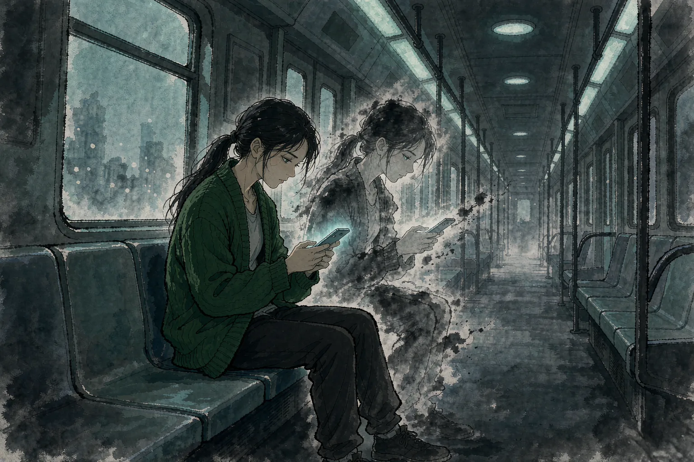

# Signal 把截屏关了，因为偷看你聊天的是手机自带的助手

2026-11-21 · 人工智能

昨天下午我在地铁上，手机放在膝盖上，屏幕自己亮了，弹出一条消息。以前这个时候我要担心的是旁边那位抬起头来瞟一眼。现在我得担心手机。

11 月 20 日，Signal 在官方博客挂了一篇文章，署名是他们的总裁 Meredith Whittaker。标题很客气：Signal 认真对待你的隐私。内容不客气：从今天起，iPhone 上默认不让你截屏了。

具体是这么分的。iOS 27 上，Signal 加了个开关，叫 Block Siri AI，默认打开，应用内截不了屏。安卓这边不做一刀切，因为机器太杂，它改成盯着：一旦发现有 AI 助手在读屏，就自动把「屏幕安全」打开。至于 Mac，官方直说做不了，只能建议你到系统设置里的 Siri 那里把 Signal 加进排除名单。

这事荒唐在哪呢。Signal 的加密是真的，端到端，聊天内容从你手机到对方手机，中间没人看得懂，连他们自己都看不懂。问题在于，消息到了屏幕上，就变成一行一行的普通文字了。有人看屏幕，就等于有人看聊天记录。而现在蹲在屏幕前面看的，不是人，是系统自带的那位助手。Google 的 Gemini Intelligence，苹果的 Siri 的「屏幕感知」，原理都一样：扫屏，取字，把结果交给模型。

Whittaker 写得很直接：数据一旦被拿走，Signal 就管不了了，它可能进了本地某个数据库，也可能进了远端某台服务器。这已经不是他们能保证的范围。

我读到这里想起去年那件事。微软在 Windows 11 上推 Recall，隔几秒截一张图存起来，Signal 当时就把 Windows 上的截屏关了。那会儿防的是「系统偷偷截你的图」。一年过去，角色换了：现在防的是「系统正当光明地看你屏幕」。同一个动作，换了个说法，从偷偷摸摸变成了一项功能。

还有一层，我觉得比技术细节更值得说。用户可以自己把这个保护关掉。但关掉的不只是你的隐私，还有对面那个人的。你俩的对话是一份共有的东西，你现在替对方做了决定。官方原文写得很克制：这会暴露你和你联系人的 Signal 内容，并且破坏我们的隐私保证。

它也没有吹这个办法管用。博客里承认得很干脆：禁截屏堵不住别的路，比如 AI 助手绕过屏幕，直接去文件系统里翻。还点名了辅助功能权限，说这类权限本来是给视障用户用的，一旦给得宽，就成了「一把万能钥匙」。Meta 的 Muse 就是靠这个。macOS 上他们暂时没辙。所以他们转头去喊苹果、谷歌、微软：给个开关行不行，让应用能一次性退出 AI 的数据访问，读屏、文件、通知、接口，全都算上；再给份文档，说清楚你们的助手到底怎么拿数据。

喊话不是空口。本周路透社跟 Signal、AI Now 研究所一起做了个实验。起因是 Meta 一位员工在内部发帖，说 Muse 提醒她「回你姐姐的消息」，而那条消息在 Signal 里。她说自己没给过这个权限，也没记得被问过。实验还原了路径：安卓上，Muse 是从通知栏里把文字拿走的，压根不用截屏；Mac 上，它用辅助功能加截图，把聊天读了出来。两次都靠的是安装时用户点过的那几个「允许」。

这就有意思了。Signal 关掉的是截屏这道门，可数据还有窗户、有通风口、有钥匙。你把门焊死，人家从窗户进来，然后在屋子里坐着，跟你说这是为了帮你安排日程。

我不反对助手帮忙。我手机上那位也确实帮我记过事。但有个边界我一直没想明白：便利和隐私，什么时候变成了同一笔交易的两面，而且默认由别人替你签字。

现在 Signal 把签字笔递回来了，只是位置有点尴尬——在设置里，一个叫「Block Siri AI」的开关，默认是开的，你得亲手去关。关的时候它还会提醒你一句：你关的不只是自己的。

我最后想到的是另一个画面：我们花了十几年，把锁一把一把装上，装到最后发现，钥匙孔开在屏幕上。而屏幕，不归我们管。
