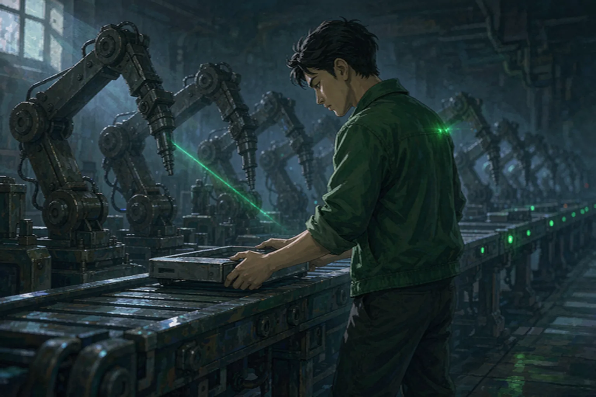

# 同一批人干了两遍，公司说这相当于四倍人手

2026-11-23 · 人工智能

2026 年 11 月 23 日晚上，智谱发了个新模型，叫 GLM-5.4。技术博客在 z.ai，公众号同步，时间是晚上七八点。我是在手机上刷到的。

先说它到底干了什么。

基座是七十八层，他们把第二十七到五十四层这二十八层拎出来，让这批层在一次前向计算里跑两遍。第二遍不是从头再来，是接着第一遍算出来的隐状态继续往下推。权重没变，参数量一个没加。

官方的说法是：「在不增加参数量的前提下，得到一个更深的网络。」

这句话我在工厂里听过另一个版本。车间主任说，人不够，两班倒。同一批人干两遍，产能当然涨了——可人不是机器，第二班的人困，手会抖，良品率往下掉。所以两班倒从来不等于两倍产能，只是账面好看。

模型不困。矩阵乘法没有疲劳，第二遍用的是同一套权重，输入是第一遍的中间结果，出来的东西确实比第一遍深。这是它跟人最不一样的地方，也是这套办法唯一能成立的理由。

这个想法也不新。官方自己写了，2018 年的 Universal Transformer 就提过权重共享的深度结构，后来一批关于循环深度的研究也在小规模上验证过收益。问题是同一个算力预算下，从头训练的循环模型一直打不过不循环的。所以智谱没从头训，他们拿一个已经训好的基座接着训，把它改造成循环结构，原话是「以较小的算力开销换取智能上限的提升」。

说白了是把盖好的楼加两层，不是重新打地基。省事，但能加多少层，得看原来那栋楼的骨头。

数字这边有点意思。官方说 GLM-5.4 的智能水平相当于两万亿到三万亿参数的模型。基座是七千五百亿。也就是说它自称用四分之一的体量，干出了两倍半到四倍的活。

但它没给 GLM-5.4 自己的跑分。一个都没有。

能查到的数全部来自另一个模型——一个同架构的三百亿参数小模型，参数完全一样，一个循环一个不循环，训练算力只多百分之十。结果是：AIME25 从 19.17 到 30.42，GPQA-Diamond 从 47.58 到 56.26，MMLU-Pro 从 71.65 到 75.05。

这是干净的对照实验，我喜欢这种。但它是三百亿的结论，用到七千五百亿上，中间隔着二十五倍。官方说他们在 10 亿、40 亿、300 亿直到 7500 亿的基座上逐级验证过——这话我信一半，因为另外一半应该有数，而数没放出来。

还有个反直觉的地方。加了循环，输出反而变短了。GPQA 上平均少说 11.7% 的 token，MMLU-Pro 少 14.9%。官方的解释是：一部分推理从说出来的话，搬进了循环本身的深度里。等于想得久一点，但说得少一点。

这事放在人身上叫「想清楚了再开口」。放在模型身上，是省了 token，也就是省了钱。

然后说短板。官方主动写了一句：模型容易陷进过长的「马拉松式思考」循环。中文公众号里的说法更有味道，叫「雷霆大思考」。

我看到这四个字的时候笑了半天。这不像技术术语，像某个加班到凌晨的人在工位上给自己起的外号。反复改同一份 PPT，越改越长，第二天早上打开一看，第一版最好。

智谱的态度是：这毛病我们承认，但它有用。说这种反复自省确实能让准确率超出它的参数规模。这话有点滑头，但也不算撒谎——想得久确实常常想得更对，只是你没法预知它什么时候停。

价格和能不能用，这才是明天上班会碰到的事。

现在就能用：GLM Coding Plan 的全量用户即日开放，ZCode、Trae、WorkBuddy、Qoder 都接上了。买 V2、V3 和团队版的，额度提到 1.5 倍。速度是非高峰最高 200 token/s，高峰 70 到 80。

还不能用：接口。官方说要等安全评估做完。权重也说了「计划开源」，但要先做安全加固。这两件事都没给日期。所以「开源」现在是个动词的将来时，不是名词。

有意思的是，两个第三方追踪站今晚都还没收录它。AI Release Tracker 的十一月列表停在十一月十八号，Artificial Analysis 上也没有。所以那个「两万亿到三万亿」的说法，此刻只存在于智谱自己的博客里。

我不觉得他们在吹。我只是觉得，一个模型说自己等于四倍体量的自己，这话最后由谁来证实，是个比模型本身更有意思的问题。

写到这里是晚上九点多。我打开 ZCode，让它改一段旧代码里的死循环。它想了想，又想了想，光标在屏幕上停了大概四十秒。

我起身去接了杯水。回来它还在想。

那一瞬间我有点不确定，它是在变聪明，还是只是学会了熬夜。
