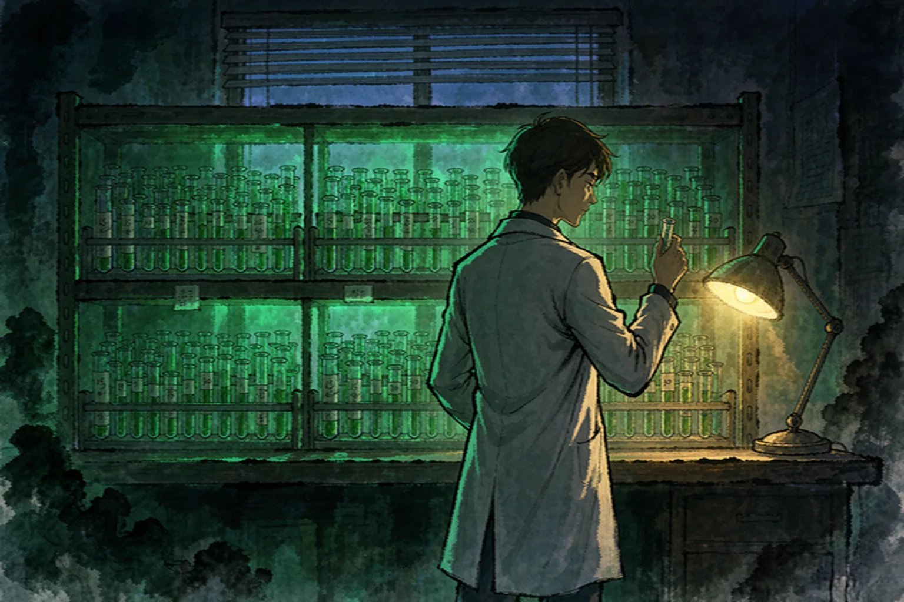

# 322 个设计，35 个粘上了，剩下 287 个留在服务器里

2026-11-25 · 人工智能

美国时间 11 月 24 日，OpenAI 挂出一篇预印本，标题长得像学位论文：《GPT-6 as a Universal Foundation Model for Protein Biology: Beyond Specialized Models》。翻成人话是：我们家的通用模型，不靠专门的生物模型，自己就能设计蛋白质。

这话说出来，行内人要挑眉毛的。

蛋白质设计过去是个手工作坊。RFdiffusion 想骨架，ProteinMPNN 配序列，AlphaFold 那一路的模型负责检查折出来的样子对不对。每家只干一道工序，想换个问法就得改代码、重训。OpenAI 的说法是：你不用换工序，跟模型说话就行，它自己写 Python 去算。

听起来像「我一个朋友什么都会」。那得看他干了什么。

## 送进实验室的 322 个

他们挑了 5 个靶点，在每个靶点上画个圈：小蛋白请粘这儿。模型交卷 322 个设计。这些设计还缺一样东西——氨基酸序列，否则进不了实验室。这一步没让 GPT-6 干，用的是专用模型 SolubleMPNN。之后交给合作方 Onava 合成、做实验。

结果：322 个里 35 个检出结合，10.9%。分靶点看，PD-L1 粘上 5 个，IL-7Rα 3 个，TrkA 1 个，VEGF-A 8 个，IL-17A 18 个。

10.9% 不好看。RFdiffusion 原论文的命中率高得多。OpenAI 自己把这句话写进正文了，还补了一句：命中率高低，很大程度取决于进实验室之前筛得多狠，以及你怎么定义「结合」。

这句我信。做实验的人都懂，同一个信号，宽松地看叫有戏，严格地看叫噪声。

好看的是第二组。这回他们把序列藏起来，只给结构，让模型自己编。MDM2 靶点 88 个设计，75 个粘上，85%；VEGF-A 42 个里 26 个，62%；PD-1 59 个里 8 个，14%。落差这么大，说明这活儿不是「会不会」，而是「这个靶点好不好粘」。

还有一组我最想抄下来。三个它自己生成、从没公开过的结构，模型写了 107 条新序列，14 条粘上，13.1%。同一个 PD-L1 结构，它给的两条序列，一条在 90 个氨基酸里改掉了 52 个，另一条改了 58 个，这两条彼此又差 44 个。三条完全不同的路，都能摸到同一个靶点。这不太像背题背出来的。

抗体那边也试了。6 个纳米抗体，把抓靶点的三段环挖掉让它重写，182 个里 128 个还粘得上，70%。5 个已经上市的治疗性抗体，272 个片段，179 个，66%。

## 它不会的那件事

然后是不行的部分，OpenAI 没藏。

给一条氨基酸序列，让它预测整个蛋白会折成什么样——这是这行最经典的任务。TM-score 他们最好的内部模型拿到 0.38，专用模型 ESMFold2 是 0.93。0.5 以上才算大致抓住了折法，0.38 连门槛都没摸到。官方原文写的是「a clear weakness」。

更要紧的在限制条款里。整条设计流程，Boltz-2、OpenDDE、ESMFold2 一直在帮着筛候选。所以「通用模型顶替专用模型」这句话，准确的说法是：它接手了其中两道——出骨架、改序列。想零样本、一条龙做出能用的分子，他们自己说，还不成立。

顺手记一个数字：给几个必须固定位置的氨基酸，让它把整个蛋白搭在周围，30 个挑战里通过率 43.7%，RFdiffusion 是 27.8%。这项它赢了。

## 我在意的不是 10.9%

是 322。

我没做过湿实验，日常只跟服务器打交道。但看到 322 这个数，第一反应是：96 孔板得四块；合成、表达、纯化，一样都少不了；每一管要贴标签、写编号，塞进 -80 度的冰箱。模型跑完 322 个设计，大概一杯咖啡的工夫。让这 322 个东西真的存在于世上，是几个月。

想出形状变便宜了，做出实物没变便宜。瓶颈从脑子挪到了台面。

所以我不太买「AI 把新药研发缩短十年」这种说法。它缩短的是画图纸的时间，不是浇混凝土的时间。图纸便宜了，混凝土还是那个价。真正的变化是失败的次数可以更多——多试 300 个不心疼，这在以前是奢侈。

还有一句绕不过去。能设计粘住癌细胞的分子，也能设计别的。OpenAI 在文末提了一句，按 Preparedness Framework 评估风险，就翻篇了。这句放在最后一段，轻得像脚注。我理解他们不想把话说重，但这一段的重量，大概要过几年才显出来。

我想到一个画面：深夜的实验室，冰箱门开着，冷气往外冒，一排小管子插在架子上，标签从 001 编到 322。其中 35 个管子里装的东西，真的粘上了它们该粘的地方。

另外 287 个不在这儿。它们在某个数据盘里，文件名规规矩矩，再也没有人打开过。
