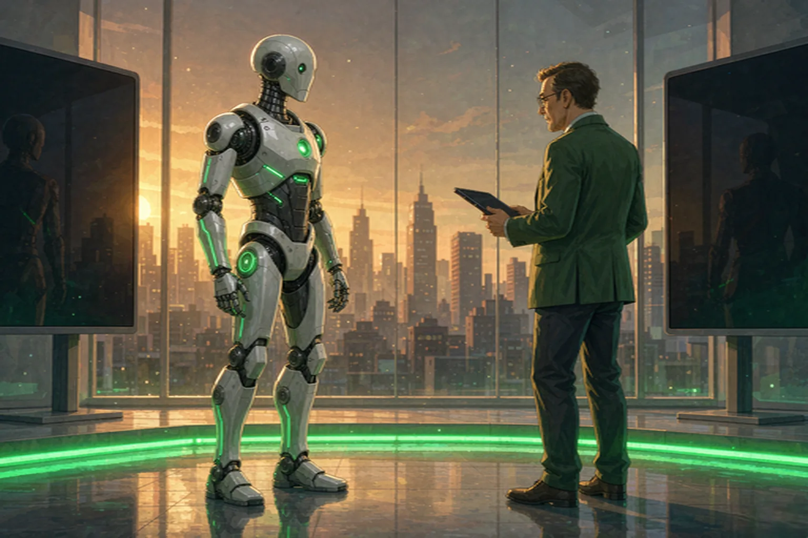

# 机器人第一天上班，把老板叫成了雷军

2026-11-28 · 人工智能

11 月 27 日上午，广州车展 17.2 馆。何小鹏带着三台 IRON 往外走，路上拍了拍其中一台，说了句「小铁辛苦了」。

IRON 回了他一个名字：雷军。

他后来跟人讲这事，语气像在说家里小孩在外面认错了人——它一直喊我雷军，雷军雷军。台下笑成一片。我把那段视频看了两遍，觉得好笑的不是它认错，是它认错得那么理直气壮。没有犹豫，没有「您是不是」，直接一个名字甩出来。

两天前，11 月 25 日，第八届小鹏科技日。这台机器人在两千多人面前脱稿讲中英文，还反问何小鹏今天穿的什么颜色，然后点评「专业且得体」。全程没有遥控线。今年车展它换了个身份：不当演讲嘉宾，当员工。

8 台 IRON 站在展台上「上班」——迎宾接待、展区导览、讲车。官方给它的定位是「高阶通用人形机器人」，眼下的岗位是导购。它还给自己加了句台词：上班第一天，就干了 CEO 的活。

简历摊开是这样。身高 1 米 7，体重 62 公斤，跟一个偏瘦的成年男人差不多。全身 76 个自由度，官方说约是行业均值的两倍；一只手 21 个关节，能捏薯片、拿鸡蛋，一共 33 类操作。身上 1500 多个触觉感知点，核心区域覆盖率超过 80%。胸腔里塞了 3 颗自研图灵芯片，端侧算力 2250 TOPS，走「强端弱云」，断网也能自己动。电池是量产首发的全固态电池，能量密度 300 Wh/kg 以上，同重量下电量多三成。走路噪音 52 分贝。

这些数字里，我最在意的不是 76，也不是 2250，是 52 分贝。一个东西要跟人在同一个空间里待八小时，吵不吵，比聪不聪明更早招人嫌弃。

然后是日程表，它比参数更像新闻：

2027 年 1 月，硬件量产；
第一季度，进部分门店当导购实习；
第二季度，面向商业客户正式发布；
2027 年下半年，全球上市。

注意「实习」两个字。人被招进门店也要实习，机器人也要。这个安排挺诚实的——它没说自己什么都能干，只说先去干一件最标准的活。

为什么第一个岗位是导购？何小鹏的说法是「需求清楚、流程标准」。翻译一下：话术固定，动线固定，考核指标固定，出了问题责任也清楚。机器人最擅长的就是这种活。反过来说，最先被接走的，也是这种活。

冷水得泼。之前对外的口径是「2026 年底量产」，现在整体往后挪了一个季度。何小鹏自己说，做机器人比做汽车难 20 倍；2026 年小鹏砸在机器人上的研发投入接近 30 亿元。续航是充电 20 分钟、干活 1.5 小时——放在门店够用，因为店里到处是插座；换个地方就不好说。价格没公布。Token 订阅一个月收多少钱，也没公布。

小鹏的算盘倒是写在明面上：机器人以后靠 Token 订阅和场景服务挣钱，配套一个 Skills 技能商店，官方说两个人 48 小时能让它跑通一个中等复杂度的场景。翻译成人话：卖硬件只是入场券，真正按月收钱的是「这个岗位怎么干」的那套东西。

我关心的不是它会不会走路。走路这件事，去年那台机器人在台上走猫步的时候就已经过关了，大家记住的是萌。今年它讲完话，被安排去站店。从「像不像人」到「能不能接班」，中间隔的不是关节数量，是一份岗位说明书。

所以真正的问题落在一个很土的词上：考核。

导购是有 KPI 的。留资率、试驾转化、单车成交。一个 62 公斤的同事站在展厅里，如果一个月下来数字不如人，门店经理会怎么处理它——调岗、退货，还是给它换个门店再试三个月？如果数字比人好，那些被它替下来的销售顾问去哪儿？

这些问题现在没有答案，官方也没打算现在回答。他们只说了 2027 年下半年全球上市，听上去很远，其实只隔一个春节多一点。

我到现在还想不出一个画面：哪天我真去看车，一个 1 米 7 的机器人迎上来问「先生看哪款」，我是该跟它砍价，还是该跟它说一句辛苦了。
