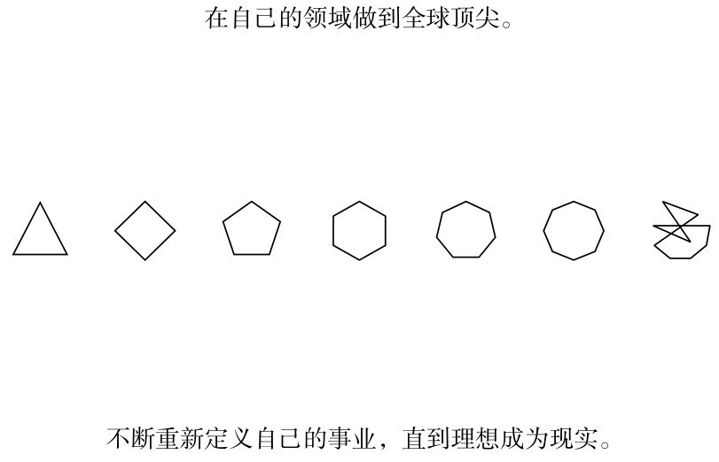
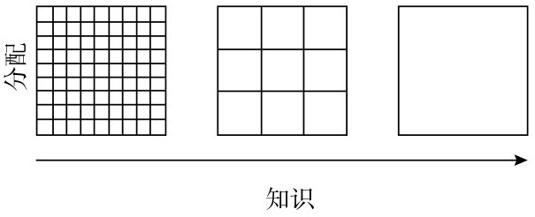
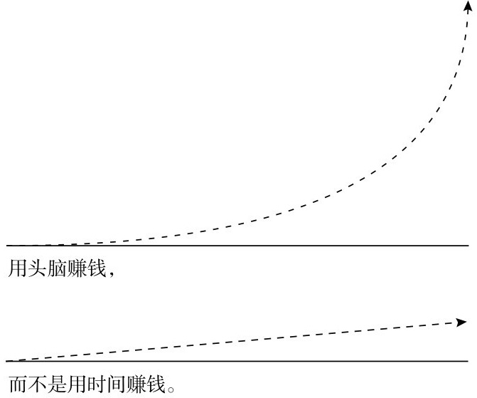
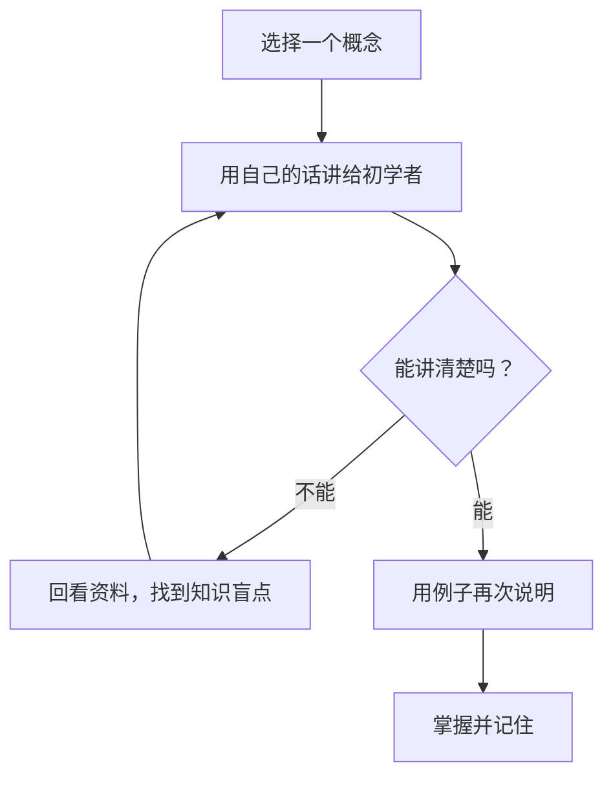

# 纳瓦尔宝典：财富、幸福与人生选择

2026-11-04 · 阅读 · 人生哲学

阅读进度：chapter 1

这篇笔记先按主题搭好框架，阅读时逐步补充观点、摘录和自己的思考。

## 阅读缘起

- 为什么想读这本书：
- 我最想从书中找到答案的问题：
## 引言
### 樊登引言
财富与幸福来自选择，作者直言这就是成功学原理，但是学到了这些东西，也无法保证你成功。培训机构卖的东西都是预制菜，美味可口高利润但是缺乏锅气。你学的知识也是一样的，如果只能是一盘预制菜，那么能够大规模替代你的人会有很多，如果你是一名真正的优秀厨师，相对来说你可替代性就会降低很大。同一个教室走出的学生天差地别，因为有人等着被打造，有的在探索自己的道路
成功其实无法教授，写到书中的成功学也无法复制。找到社会的需求点，找到属于自己的独一无二的解决方案，社会会把你的欠条还上，你自然能过上良好的生活
### 范兵（《增长黑客》作者）
1. 八年前读过增长黑客，对互联网的病毒营销和网站粘性留存率，范冰拥有一套完整的见解，我在找工作时候甚至把他当作求职宝典。
2. 你无法靠出卖时间变富，而是需要资产（公司、股票、实业）或被动收入（代码或媒体）。为此，你需要调动劳动力、资本的杠杆，并创造无复制成本的产品，最终将财富转换成享有幸福和自由的权利。
3. 最重要的是，要在重大决定上花更多时间。人生早期有三个重大决定：在哪里生活，和谁在一起，从事什么职业
4. 不要读畅销书，不要看新闻，不要加入读书会，真理至于社群之上
### 作者序言
- 对近乎一切都持怀疑态度；
- 从第一性原理出发进行思考；
- 可以对人对事进行有效测试；
- 从不自我欺骗；
- 不时调整自己的观点和看法；
- 经常开怀大笑；
- 有大局观；
- 眼光长远；
- **不把自己太当回事**。

最后一点非常重要。认真阅读和品味但是不要照搬。
---
## Part 1 财富：专长、创造与杠杆(Part of wealth) - 不靠运气致富
### Chapter 1 积累财富
- 赚钱不是你想做就能做到一件事情，而是一门需要学习的技能
#### 认识财富原理
1. 财富是你在睡觉时候还能为你赚钱的资产
2. 获得财富的途径就是为社会提供有需求但是无从获取的东西，并规模化
3. *专长*是无法通过培训获得，如果社会可以培训你，也能培训人取代你。累计专长对你而言就像玩耍，对别人来说很痛苦
4. 利用杠杆效应。商业资本来源于资本、劳动力、**复制边际成本为零的产品** - 代码/媒体
5. 如果不会写代码，出书，写博客，做视频，录播客
6. 在自己选择的职业领域里做到全球顶尖。不断重新定义自己的事业，直到理想成为现实
> 就是要把自己产品化，自己有独特性有责任感，产品化有专长，能发挥杠杆效应
##### 自己产品化
把自己产品化需要花费几十年，不是执行端的挑战而是要把大部分时间用于思考
##### 财富与金钱的区别
- *金钱*是我们转移财富的方式。金钱是社会的信用符号，具有调用别人时间的能力。
- *财富*的定义是在睡觉时也能带来收入的企业和资产
#### 找到天赋所在，积累专长
> 专长无法被教授，但可以被学习。
1. 通过一些学习可以锻炼专长，自驱力为主
2. 应用科学家是推动技术进步，社会，商业金钱都是下游产物
3. 只有独辟蹊径，才能避开竞争
4. 最好的工作与委任或学位无关。最好的工作是终身学习者在自由市场中的创造性表达。

5. 有些东西你需要深入研究，否则你只能做到“样样都通，样样稀松”，无法实现人生目标。一个人只能在一两件事上做到精通，而这一两件事通常是让你痴迷的事情
---
> 我感觉我最擅长的应该是技术文档归类新技术探索带大家去做一些AI例子，可是目前投入的时间和精力不足所以目前还未突破，fengsKB是一个良好的开端
>
#### 投资交友
1. 一个人声誉好，数十年如一日不断打造声誉，他就会得到关注和重视
2. 99%的努力终将白费，所以要花更多时间找到能产生复利的1%，然后用尽一生去努力
3. 出发点并不重要，行为本身才重要。因此，遵守道德标准并非易事。
#### 承担责任
1. 勇于以个人名义承担商业风险。社会将根据责任、股权和杠杆效应回报你。
> 表现一些自己的唯一，个人承担社会责任和风险，社会自然会回报你
2. 失败真的没有那么可怕，所以我们都应该勇于承担更多责任

#### 创立企业或者买入股权
1. 没有股权就没有通向财务自由的道路
出卖时间赚取报酬不是可持续的致富之路，资本家付给你价值远远低于你创造的价值。他在承担更大的社会风险和责任的同时也获得了更多的利润。
#### 找到杠杆
1. 求知欲和兴趣爱好结合，我们就能找到我们所爱
2. 如果一件事一开始让你兴趣盎然，后来你又觉得索然无味，那他只是短暂的分散了你的注意力，并不是你心智上好奇心所在，请继续寻找。
- 三种杠杆
  - 劳动力杠杆 最低效的一种，管理人是最复杂的杠杆，极具挑战
  - 资本杠杆 用金钱产生影响，这是20实际最主要的杠杆
  - **复制边际成本为零的产品** 普通人触手可及
> 人不分穷人富人，白领蓝领，现代人二分法是利用杠杆的人和没有利用杠杆的人
1. 对利用杠杆的人判断力的重要性远超投入时间长短和工作努力程度
2. 别说把编程效率提高10倍了，提高1 000倍的情况也是真实存在的，只是我们没有完全认识到这一点——看看推特上值得关注的约翰·卡马克、马库斯·佩尔松、中本聪
3. 想加入一家伟大的科技公司，销售技能和构建技能必备其一，缺什么补什么
#### 房地产举例

一定要避免身败名裂，锒铛入狱

#### 用判断力挣钱
> 在你所属的行业优秀的基础上稍微提高一些，做到卓越，做到极致非常重要
#### 分清主次，聚焦重点
1. 给自己定一个很高的时薪，如果做的事情价值比这个高就去做，比这个低果断外包
> 现在是时薪是 100rmb/h 定500rmb/h
2. 内心鄙视财富，财富就会对你敬而远之。长远看，乐观主义者会有更好的发展
3.  - 大多数人在玩零和游戏，少数人在玩正和游戏
        - 零和游戏就是地位之争，伤害他人。愚蠢人玩愚蠢游戏，获得愚蠢奖品
        - 正和游戏,财富创造，近代才出现
4. 初出茅庐年轻人，你要在重大决定上花时间去思考，在哪里生活，跟谁在一起，从事什么职业
5. 提供免费产品和服务不要计较回报，一旦开始计较你就会失去耐心
#### 找到能玩耍的公司-这样你就不会累和负担
1. 钱还是手段不是目的，赚到钱不要升级生活方式可能是一个好的选择
2. 达到退休，一存钱，二出家，三找到自己热爱的事情，乐在其中
3. 任何游戏的赢家都是那些沉迷于游戏的人，即使获胜的边际效用越来越少，他们也会继续玩下去。 
#### 如何获得运气
- 运气分四种
  - 不期而遇，纯外力，意外之财，遇到贵人 
  - 依靠坚持不懈，释放和积累能量,好运自来
  - 善于发现好运，熟悉某个领域，敏感度高
  - 打造独特个性和品牌,独特心态，让好运主动来找你
- 获得好运的方法：
  - 希望好运不期而至。
  - 不停地折腾，直到撞上大运。
  - 做好心理准备，对别人错过的机会保持敏感。
  - 把你所做的事情做到极致。精益求精，直到名副其实。让机会自动找到你，让运气成为必然。
1. 名声和人品最重要，有了这些就会有很多机会
2. 在一个长线游戏中每个人让彼此都在变得富有，短线游戏中每个人都只让自己富有
3. 做一个创造者，创造出人们想要的有趣的东西，展示你的技能，锻炼你的技能，最终会有合适的人找到你
4. 做一些自己觉得不光彩的事情，这些事情最终会伤害到你。
5. 越接近我的人，价值观必须越正确
#### 保持耐心
1. 运用专长，结合杠杆效应，你的才华和努力最终会得到相应的回报
2. 主动付出，不断奉献，不斤斤计较，患得患失
3. 让人快乐的方法就是满足他们的欲望，都富裕，健康，快乐
4. 很多人把财富和智慧混为一谈
### Chapter2 增强判断力
#### 判断力
1. 真正聪明人从不走捷径
2. 时间花在省钱上是不会致富的，省出时间来赚钱才是正确的思路
3. 方向（判断力）比努力更重要，人生就是选择方向不断狂奔
#### 如何清晰的思考
1. 思路清晰比所谓的聪明是一种更好的赞誉
2. 费曼学习法

3. 欲望太重看不清现实
4. 每周留下至少一天时间不要开会处理事情，去思考，倍感压力和焦头烂额之人无法思考和进步
5. 非常聪明的人往往都是特立独行的，他们坚持独立思考、亲力亲为，以厘清事情的来龙去脉。