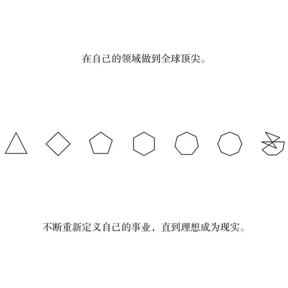
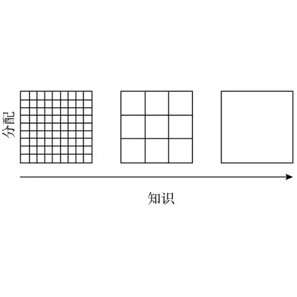
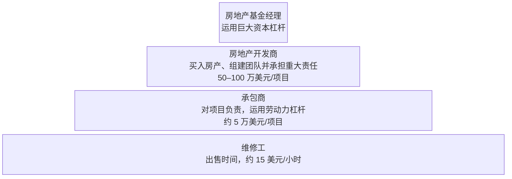
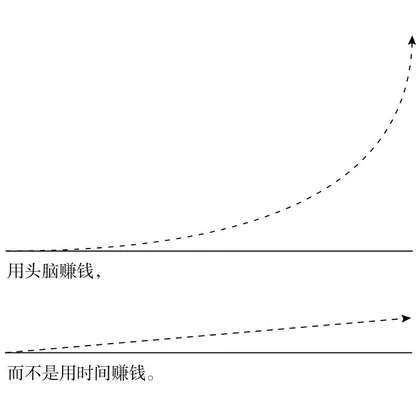
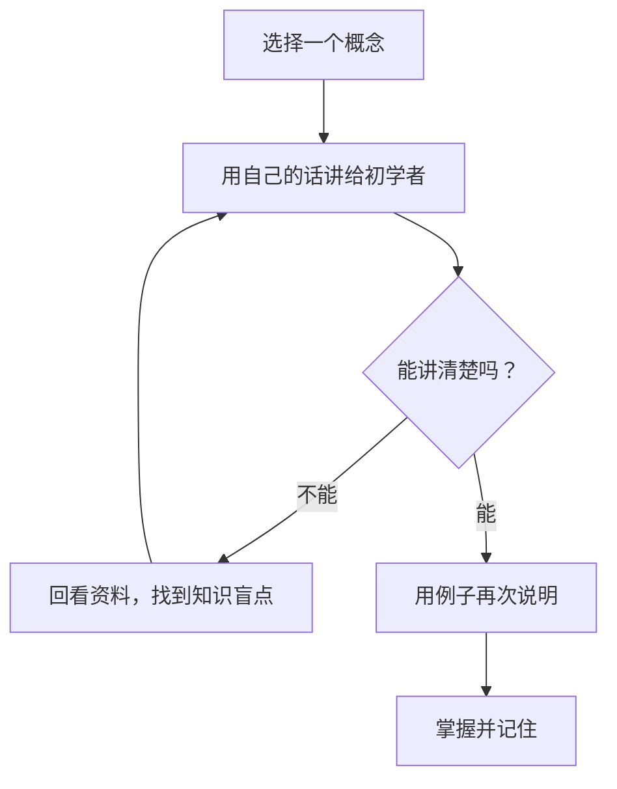

# 纳瓦尔宝典：财富、幸福与人生选择

2026-11-04 · 阅读 · 人生哲学

## 阅读缘起

- 为什么想读这本书：在博客中听马斯克的介绍，主持人一直在提纳瓦尔就来拜读下
- 我最想从书中找到答案的问题：我将来的做什么，什么可以变现，如何生活的更好

## 引言
### 樊登引言
财富与幸福来自选择，作者直言成功学原理并不能保证你一定成功。培训机构出售的知识有时像预制菜：美味可口、利润很高，却缺少真正的锅气。你学到的知识也是如此，如果只能成为一盘预制菜，就会有很多人能够大规模替代你；如果你是一名真正优秀的厨师，相比之下就不会轻易被替代。同一个教室走出的学生天差地别，有人等待被塑造，有人在探索属于自己的道路。

成功其实无法教授，书中的成功学也无法照搬复制。找到社会的需求，**找到属于自己的独一无二的解决方案，社会自然会给予回报，你也就能够过上更好的生活**。
> AI技术应用(音视频文本生成)+个人文学/音乐思考

### 范冰（《增长黑客》作者）
> 八年前读过《增长黑客》，范冰对互联网的病毒式营销和网站留存率拥有一套完整的见解；我在找工作的时候，甚至把它当作求职宝典。
1. 你无法靠出卖时间变富，而是需要资产（公司、股票、实业）或被动收入（代码或媒体）。为此，你需要调动劳动力、资本的杠杆，并**创造无复制成本的产品，最终将财富转换成享有幸福和自由的权利**。
3. 最重要的是，要在重大决定上花更多时间。人生早期有三个重大决定：在**哪里生活、和谁在一起、从事什么职业**。
4. **不要只读畅销书**，不要只看新闻，也不必加入读书会；真理应高于社群共识。
> 不要读畅销书，读名著原著
### 作者序言
- 对近乎一切都持怀疑态度；
- 从第一性原理出发进行思考；
- 可以对人对事进行有效测试；
- 从不自我欺骗；
- 不时调整自己的观点和看法；
- 经常开怀大笑；
- 有大局观；
- 眼光长远；
- **不把自己太当回事**。

>最后一点非常重要。认真阅读和品味,但是不要照搬他人的感悟和想法。
---
## PART ONE WEALTH 财富：专长、创造与杠杆（Part of Wealth）——不靠运气致富
### CHAPTER ONE 积累财富
- 赚钱不是你想做就能做成的事情，而是一门需要学习的技能
#### 认识财富原理
1. 财富是即使在你睡觉时也能为你赚钱的资产
2. 获得财富的途径，就是为社会提供有需求却难以取得的东西，并实现规模化
3. **专长**无法通过培训获得；如果社会可以培训你，也就能培训别人来取代你。积累专长对你而言像是在玩耍，对别人来说却很痛苦
4. 利用杠杆效应。商业资本来源于资本、劳动力、**复制边际成本为零的产品** - 代码/媒体
5. 如果不会写代码，出书，写博客，做视频，录播客
6. 在自己选择的职业领域里做到全球顶尖。不断重新定义自己的事业，直到理想成为现实
> 就是要把自己产品化，自己有独特性有责任感，产品化有专长，能发挥杠杆效应 - 去抄抄 Dan koe/Naval/ Elon Mask
##### 自己产品化
把自己产品化需要花费几十年，不是执行端的挑战，而是要把大部分时间用于思考
##### 财富与金钱的区别
- **金钱** 是我们转移财富的方式。金钱是社会的信用符号，具有调用别人时间的能力。
- **财富** 的定义是在睡觉时也能带来收入的企业和资产
#### 找到天赋所在，积累专长
> 专长无法被教授，但可以被学习。
1. 通过一些学习可以锻炼专长，自驱力为主
2. 应用科学家是推动技术进步，社会，商业金钱都是下游产物
3. 只有独辟蹊径，才能避开竞争
4. 最好的工作与职位委任或学位无关。最好的工作，是终身学习者在自由市场中的创造性表达。

  

5. 有些东西你需要深入研究，否则你只能做到“**样样都通，样样稀松**”，无法实现人生目标。一个人只能在一两件事上做到精通，而这一两件事通常是让你痴迷的事情
---
> 我感觉我最擅长的应该是技术文档归类新技术探索带大家去做一些AI例子，可是目前投入的时间和精力不足所以目前还未突破，fengsKB是一个良好的开端
>
#### 投资交友
1. 一个人声誉好，数十年如一日不断打造声誉，他就会得到关注和重视
2. 99%的努力终将白费，所以要花更多时间找到能产生复利的1%，然后用尽一生去努力
3. 出发点并不重要，行为本身才重要。因此，遵守道德标准并非易事。
#### 承担责任
1. 勇于以个人名义承担商业风险。社会将根据责任、股权和杠杆效应回报你。
> 展现自己的独特性，敢于以个人名义承担社会责任和风险，社会自然会回报你
2. 失败真的没有那么可怕，所以我们都应该勇于承担更多责任

  

#### 创立企业或者买入股权
1. 没有股权就没有通向财务自由的道路。
出卖时间赚取报酬不是可持续的致富之路，资本家付给你的报酬远低于你创造的价值。他在承担更大的社会风险和责任的同时也获得了更多的利润。
#### 找到杠杆
1. 求知欲和兴趣爱好结合，我们就能找到我们所爱
2. 如果一件事一开始让你兴趣盎然，后来又觉得索然无味，那它只是短暂地分散了你的注意力，并不是你内心真正的好奇所在，请继续寻找。
- 三种杠杆
  - 劳动力杠杆 最低效的一种，管理人是最复杂的杠杆，极具挑战
  - 资本杠杆 用金钱产生影响，这是20世纪最主要的杠杆之一
  - **复制边际成本为零的产品** 普通人触手可及
> 人不分穷人富人，白领蓝领，现代人二分法是利用杠杆的人和没有利用杠杆的人
1. 对利用杠杆的人判断力的重要性远超投入时间长短和工作努力程度
2. 别说把编程效率提高10倍了，提高1000倍的情况也是真实存在的，只是我们没有完全认识到这一点——看看推特上值得关注的约翰·卡马克、马库斯·佩尔松、中本聪
3. 想加入一家伟大的科技公司，销售技能和构建技能必备其一，缺什么补什么
#### 房地产例子

一定要避免身败名裂、锒铛入狱。

  

#### 用判断力挣钱
> 在你所属的行业优秀的基础上稍微提高一些，做到卓越，做到极致非常重要
#### 分清主次，聚焦重点
1. 给自己定一个很高的时薪，如果做的事情价值比这个高就去做，比这个低果断外包
> 现在的时薪是 100 RMB/小时，目标是 500 RMB/小时。
2. 内心鄙视财富，财富就会对你敬而远之。长远看，乐观主义者会有更好的发展
3. 初出茅庐的年轻人，应当在重大决定上多花时间思考：在哪里生活、和谁在一起，以及从事什么职业。
4. 提供免费产品和服务不要计较回报，一旦开始计较你就会失去耐心
- 大多数人在玩零和游戏，少数人在玩正和游戏
  - 零和游戏就是地位之争，伤害他人。愚蠢人玩愚蠢游戏，获得愚蠢奖品
  - 正和游戏：财富创造，近代才出现
#### 找到能让你享受的工作，这样就不会感到疲惫和负担
1. **钱还是手段不是目的**，赚到钱不要升级生活方式可能是一个好的选择
2. 退休有三种方式：攒够钱、隐居，或者找到自己热爱的事情并乐在其中
3. 任何游戏的赢家都是那些沉迷于游戏的人，即使获胜的边际效用越来越少，他们也会继续玩下去。 
#### 如何获得运气
- 运气分四种
  - 不期而遇，纯外力，意外之财，遇到贵人 
  - 依靠坚持不懈，释放和积累能量，运气自会到来
  - 善于发现好运，熟悉某个领域，敏感度高
  - 打造独特个性和品牌，以独特心态让好运主动找上门
- 获得好运的方法：
  - 希望好运不期而至。
  - 不停地折腾，直到撞上大运。
  - 做好心理准备，对别人错过的机会保持敏感。
  - 把你所做的事情做到极致。精益求精，直到名副其实。让机会自动找到你，让运气成为必然。
1. 名声和人品最重要，有了这些就会有很多机会
2. 在一个长线游戏中每个人让彼此都在变得富有，短线游戏中每个人都只让自己富有
3. 做一个创造者，创造出人们想要的有趣的东西，展示你的技能，锻炼你的技能，最终会有合适的人找到你
4. 做一些自己觉得不光彩的事，这些事最终会伤害到你。
5. 越接近我的人，价值观必须越正确
#### 保持耐心
1. 运用专长，结合杠杆效应，你的才华和努力最终会得到相应的回报
2. 主动付出，不断奉献，不斤斤计较，也不患得患失。
3. 让人快乐的方法就是满足他们的欲望，都富裕，健康，快乐
4. 很多人把财富和智慧混为一谈
### CHAPTER TWO 增强判断力
#### 判断力
1. 真正聪明人从不走捷径
2. 时间花在省钱上是不会致富的，省出时间来赚钱才是正确的思路
3. 方向（判断力）比努力更重要，人生就是选择方向不断狂奔
#### 如何清晰的思考
1. 思路清晰比所谓的聪明是一种更好的赞誉
2. 费曼学习法

1. 欲望太重看不清现实
2. 每周留下至少一天时间不要开会处理事情，去思考，倍感压力和焦头烂额之人无法思考和进步
3. 非常聪明的人往往都是特立独行的，他们坚持独立思考、亲力亲为，以厘清事情的来龙去脉。
#### 摆脱自我束缚 认清世界真相
1. 我们习惯的自我认知，自我认同，自我意识交织在一起，对习惯形成深深依赖
2. 我们要在不同阶段反思自己的习惯是否有利于当下和未来的发展，并尽早摒弃过时的习惯
3. 每个人都有一些离经叛道的信仰，这些信仰越不被社会接受，他就越可能符合现实，如果你的所有认知可以打包加入某个主义，那么你要小心了，可能你也是被裹挟了
#### 学习决策技巧
1. 要看长期收益，不能只顾眼前
2. 偏见都是为了帮助我们在信息不完整的情况下迅速做出判断，重要决策时候一定要只看事情本身，抛开偏见
> - 具体表扬
>   - 表扬一个具体的人为我所用
> - 具体批评
>   - 不要批评人，要批评方法和行为
1. 越觉得自己无所不知，规避和处置风险的方法就越少
2. 一个决策正确率为80%的人比正确率为70%的人在市场上的价值和获得的回报要高出数百倍
#### 发现好的心智模型
1. 心智模型其实就是有助于你调取你所学知识的简单方法
- 进化论
  - 人类社会精子充足，卵子稀少，存在分配问题，所以人类的发明创造都是为了解决这个问题
- 反推法
  - 成功不在于做出正确判断，在于避免错误的判断
- 复杂理论
  - 人类是无知的，是极不擅长预测未来
- 经济学
  - 了解**供求关系，劳资关系，博弈论**，否则无法成功
- 委托人/代理人
  - 委托人就是主人翁，关注结果能把事情干好
  - 代理人是替别人打工，为自己牟利，所以可能缺乏主人翁意识
- 复利
  - 从头到尾认真研读一本微观经济学教科书，你会受益匪浅
- 基础数学
  - 加减乘除，复利计算，概率论
- 黑天鹅
  - 纳西姆·塔勒布在黑天鹅（尾部事件）研究方面做了很多开创性工作
- 微积分
  - 了解认识变化的速度和自然界的运作方式
- 可证伪性
  - 无法做出可证伪性预测，那就不是科学
- 如果难以抉择，答案就是否定答案
- 如果一个艰难决定无法立刻做出，那么就选择短期内更痛苦的道路，我们生命中大部分的收获都是来自承受短期痛苦带来的长期回报
- 如何提升心智模型
  - **每天花一个小时阅读科学、数学和哲学类书籍**，7年内，你就可能跻身少数的成功人士之列
#### 学会热爱阅读
1. 阅读是我的初恋
2. 阅读自己喜欢的题材，直到热爱阅读
3. 不要比读得多，读的快，书越好越要慢慢读，慢慢吸收
4. 一书在手便不觉浪费时间
5. 向别人讲解你学到的东西。教学相长
6. 自媒体降低了你整块的阅读能力，但是提升了你输出和写作的能力
> 整本书去阅读的机会会越来越少，自媒体时代信息全部被切碎，大家使用碎片化的时间获取碎片信息
> 要适应这个节奏，每本书不必读完；流传千年的经典则一定要去读原文。
> 作者建议从微观经济学、达尔文进化论和宏观经济学入手，再延伸到亚当·斯密、马克思等思想，以原著和经典著作为基础。
> 你就不会惧怕任何人任何理论，拥有洞察社会本质的力量
> 一颗平静的心，一个健康的身体，一个充满爱的家。这些东西是金钱买不到的，必须通过努力才能获得。
---
## PART TWO HAPPINESS 幸福
### CHAPTER THREE 幸福
> 人生的三大要素是财富、健康和幸福。
> 我们依次追求财富、健康和幸福，但按重要性排序则是反过来的。
#### 学习幸福
1. 幸福是一种技能，可以后天习得
2. 幸福是一种不需要主动作为的状态，把缺憾感剔除，幸福感油然而生
3. 幸福是没有痛苦，没有欲望，不沉溺于对未来和过去的思考，真正拥抱当下，拥抱现实的一切
4. 如果想获得内心平静你就要超越对万事万物的善恶评判
5. 幸福不是客观存在，是主观感受
6. 幸福就是消除缺憾感之后的感受
7. 剔除幸福与不幸福这两种状态，剩下的是中性状态，但这并不意味着平淡无趣。中性状态更接近孩子的状态，只有孩童才能真正沉浸其中、感受环境，而不是期待环境契合自己的喜好和愿望
8. 理性很强的人可以通过训练自己的无感反应获得平和，即学会漠视自己无法控制的事物。
9. 有条不紊的进步去提高自己的幸福基线，就像提高身体素质
>一些获得幸福的技巧
>我降低自己的身份感。
>我屏蔽脑海中的噪声和杂念。
>我不在乎那些无关紧要的事。
>我不参与政治。
>我远离郁郁寡欢的人。
>我珍惜光阴。
>我阅读哲学作品。
>我进行冥想练习。
>我和快乐知足的人交往。
#### 幸福是一种选择
1. 我们渴望那些让我们能感知当下的体验，殊不知，这样的渴望却让我们脱离了当下。
2. 你有没有想过，现在的生活可能就是上帝承诺给你的天堂，而你却毫不珍惜，肆意挥霍？
#### 幸福是我们做出的选择
每天的大脑都像是重新开启的状态；如果装满陈芝麻烂谷子和对未来的焦虑，便是在主动选择当下的不幸福。
剔除这种感觉，你才能感受到身边的幸福。
#### 幸福需要活在当下
我们渴望那些让我们能感知当下的体验，殊不知，这样的渴望却让我们脱离了当下。
#### 幸福需要心境平和
幸福的人能够以特定的方式诠释事件，并轻松地保持内心平和，不以物喜、不以己悲。
#### 欲望是主动选择的不开心
1. 欲望就是你跟自己的约定，约定的内容是：不得到我想要的东西，我是不会快乐的。
2. 年轻的时候有时间、有健康，但没有钱；中年时有钱、有健康，但没有时间；老了以后有钱、有时间，却失去了健康。**人生的大赢家就是同时拥有时间、健康和金钱**。
等到人们觉得自己已经拥有足够的金钱时，他们却失去了时间和健康。
#### 成功不一定带来幸福
>幸福就是满足现状。而成功源于对现状的不满，是对现状的改造。两者只能选一个。
1. 我认为的成功人士是李飞飞，是马斯克。
2. 我们可以从生活中得到一切，前提是你的目标只有一个，而且你对这件事情的渴望超过了一切
3. 内心平和是我追求的一切，获得内心平静的唯一方法是摒弃问题这个概念
#### 嫉妒是幸福的敌人
1. 内心平和的敌人，是社会和他人灌输给你的期望，以及各种“应该”之事。
2. 即使是“开心做自己”这件事，也在我的掌控之下，只是社会不会因此给我任何奖励
>巴菲特曾经提出这样一个问题，你是想成为世人眼里最差但自己心里最好的情人，还是想成为世人眼里最好但自己心里最差的情人？这个问题就是一个很好的例子，它说明存在内在和外部两套评价标准。
#### 幸福源于好习惯
1. 工作时，和比自己更成功的人在一起。
2. 玩耍时，和比自己更快乐的人在一起。
3. 多次尝试找到让自己进入了心流状态的方式
> 我在运动和烹饪时能够进入心流状态
4. 少喝酒、少吸烟，少喝咖啡和少打游戏，关注那些能带来长期幸福的行为，就能获得幸福感
5. 停下来看看周围其实都是令你幸福的事物，只是你自己迷失在了幸福之路上
> 这就是改变习惯的步骤：首先，明确自己要做什么；其次，找到该怎么做的方法；再次，把计划告诉朋友，让一致性偏见发挥作用；最后，严格自律、知行合一，进行自我重塑，直至蜕变成全新的自己。
#### 于接受中寻找幸福
1. 培养泰然接受一切的习惯，慢慢寻找幸福。
2. 你要把直面死亡放在第一位。人的一生，不否认、不回避死亡非常重要，因为这能帮助你学会坦然接受无法改变的事情，并真正活在当下。
3. 选择简单模式，人生会越来越困难，选择困难模式，人生会越来越简单
> 向世界传播爱，珍惜眼前的每个瞬间，养成良好的习惯，体验自己的一生
### CHAPTER FOUR 自我救赎
#### 选择做自己
1. 先天基因加后天经验会造就独一无二的一个个体，你脑海中总会有一个声音让你去做自己。不要模仿谁，听从这个声音做自己
> 我想做科技类 AI 博主，向卡兹克、Jackie Cui 那样经营公众号和内容账号。要做到这个状态，需要我近乎痴迷地投入其中。
#### 选择关爱自己
1. **健康问题**对人生影响最大：多吃蔬菜，辅以肉类和浆果；多去户外运动；保持与群体的交流互动。
2. 吃什么都可以，进食量很重要，**提高质就能降低量**。不要吃精加工食品
3. 找到适合自己的锻炼时间，**晨练**可以作为一个良好起点。坚持这一习惯后，其他生活习惯也会逐渐向它靠拢。
#### 冥想+精神力量
1. 尝试**降低洗澡水温，试试冷水**。每日一分钟试试，身体需要一些寒冷刺激
2. 冥想是思想的间歇性禁食
3. 可以尝试以下四种冥想方法，值得花时间逐一体验：
   1. 无选择觉知冥想，不要做任何决断，评判任何事，全盘接受所有事情
   2. 超觉冥想，反复唱诵，在头脑中制造白噪音掩盖自己的想法
   3. 高度警觉自己的想法，识别恐惧，消除恐惧
   4. 臣服姿态接受一切，任各种想法涌现
4. 冥想是屏蔽社会噪声专注倾听自我的过程
#### 选择自我塑造
1. 最了不起的超能力就是自我改变的能力
2. 不要总说打算，将要，这其实是畏缩，想到什么立刻就去做，迅速采取行动，并对结果保持耐心
#### 选择自我成长
1. 想做什么就现在去做，人生没有“以后”。
2. 科学研究真理的学问，数学是科学和自然的语言。还得花些时间去学习基础科学-经济学/哲学/计算机这种专业知识
3. 去读原著，不要读论文和他人的注解，很多人读书都只是为了获得社会认可，你要做的不是合群，而是要从人群中脱颖而出
4. 流血流汗、埋头苦干、直面困难，这些都是“一夜成名”之前的必经之路。
5. 必须广泛的阅读，找到自己应该读和喜欢读的东西
6. 掌握阅读、数学和说服相关的能力。
#### 学习，解放自己
1. 最难的事情不是做自己想做的事情，而是知道自己想要什么
2. 世上本无成年人，假装成熟的人多了，也就有了成年人
3. 年轻时追寻外在的自由，随心所欲地做想做的事；年长后追求内在的自由，能够选择不做不想做的事，进而实现内心与外在的无拘无束。
4. 年轻时候一定要做最真实的自己
5. 不要过于在乎别人怎么想，把自己从别人的期待中解放
6. 只要把时间用在自己想做的事情上，就不算浪费；通过不断积累，终会有所收获。
7. 愤怒是对情况失去控制的表现，是暴力的前兆
8. 一旦你品尝到自由的滋味你就再也不想被别人雇佣
9. 每个人孩童时期都是一张白纸，无忧无虑活下去，根据本能对环境作出反应，当有了欲望就会不停思考，大脑不受控，我想要叫停心猿，专注当下
> 现代斗争是，孤独的个体召唤出非人的意志力，断食，冥想，锻炼，对抗大批科学家统计学家以充足的食物，药物，电子屏幕为武器制造出的垃圾食品，标题党新闻，无限的色情内容，无穷无尽的游戏，令人上瘾的毒品
### CHAPTER FIVE 哲学
真理经常被当作异端学说，无法被公开讨论，只能靠自己去探索
#### 生命的意义
1. 生命的意义是一个私人问题，必须自己去寻找答案。这个过程可能很漫长，但一旦找到，它就会成为生活的根基。
2. 生命没有意义，生活没有目的。你死后你就消失了，一切归于热寂
3. 根据热力学第二定律，人类只能局部减少熵，宇宙整体的熵仍在增加；我们所做的一切，正是在推动宇宙加速趋向热寂。
#### 按照自己的价值观生活
1. 诚实，做自己，心口如一。因为对别人撒谎之前你必须撒谎骗自己
2. 不赞成任何短期思维和短期交易。所有的回报都来自复利
3. 平级关系，不高于或者低于任何人
4. 愤怒毫无意义，愤怒伤害的其实是自己
5. 有了孩子你的重心会转向孩子，你的价值观也不那么自私了？
#### 理性佛教
1. 人生哲学之一是进化论，它解释了关于人类的诸多问题；另一方面是佛教，关于我们每个人内心状态的精神哲学，也是最古老、经得起时间考验的哲学之一
2. 我只实践对我有意义的佛学理论，不会全盘接受，也算是中西合璧。
3. 智慧是一种知道个人行为的长期后果的思维能力，如果能通过语言传授智慧，那么我们今天就不需要努力了
#### 我们唯一拥有的就只有当下
1. 只因在劫难逃，万物更显美好，你永远不会比此刻更美，我们也永远不会重回此地
2. 死亡唯一的真正含义就是不再拥有未来的时刻

> 接下来读一下《悉达多》和《七堂极简物理课》。

---
## 行动清单

- [x] 我想结合 AI 技术应用（音视频、文本生成）与个人文学、音乐思考，构建自己的独特方向。
- [x] 我已经不只读畅销书，也开始阅读名著原著。
- [x] 不照搬他人的感悟和想法，认真阅读并形成自己的判断
- [ ] 把自己产品化：找出独特性、责任感、专长和杠杆
- [ ] 研究 Dan Koe、Naval、Elon Musk 的方法，并结合自己的实际情况使用
- [ ] 把深度学习和专长积累放在日程上，不因短期忙碌放弃
- [x] 技术文档、技术归类和新技术探索：持续投入，带团队制作 AI 示例
- [x] 写完并维护 fengsKB，把它作为积累专长的开端
- [ ] 展现独特性，以个人名义承担有现实风险的责任
- [ ] 学会利用杠杆：劳动力、资本、复制边际成本为零的产品
- [x] 在当前行业做到优秀，再持续做到卓越和极致
- [ ] 将时薪目标设为 500 RMB/小时；价值低于目标时果断外包
- [ ] 表扬具体的人和具体的贡献
- [ ] 批评具体方法和行为，不针对个人
- [x] 每周留出时间反思，不参加不必要的会议
- [ ] 从微观经济学、进化论和宏观经济学入手阅读原著
- [ ] 阅读亚当·斯密、马克思等经典原著，形成独立判断
- [x] 保持平静心态：健康、运动、阅读和亲密关系相互支持
- [x] 选择自己热爱的方向，使财富、健康和幸福保持平衡
- [x] 降低身份感，减少头脑中的噪声和杂念
- [x] 不在乎无关紧要的事，远离郁郁寡欢的人
- [x] 不参与不必要的政治争论，珍惜光阴
- [x] 阅读哲学作品并坚持冥想练习
- [x] 多和快乐知足的人在一起
- [x] 工作时靠近更成功的人，玩耍时靠近更快乐的人
- [x] 在运动和烹饪中寻找并保持心流状态
- [x] 少喝酒、少吸烟、少喝咖啡、少打游戏
- [ ] 明确目标、找到方法、公开承诺、严格自律并知行合一
- [ ] 向世界传播爱，珍惜当下，养成长期幸福的习惯
- [ ] 成为科技类 AI 博主，经营公众号和其他内容账号
- [x] 用晨练和户外运动建立稳定的生活节奏
- [ ] 每天尝试一分钟冷水刺激，观察对精神状态的影响
- [ ] 尝试无选择觉知、超觉、高度警觉和臣服姿态冥想
- [x] 饮食上提高质量、降低进食量，减少精加工食品
- [x] 把食物、运动、冥想和社交都纳入长期习惯管理
- [x] 想做的事立刻行动，不再用“以后”拖延
- [ ] 花时间学习经济学、哲学、计算机和其他基础科学
- [x] 去读原著，不把读论文或注解当作替代
- [x] 把阅读、数学和说服能力作为长期训练项目
- [x] 每天直面时间有限性，提醒自己珍惜当下
- [ ] 阅读《悉达多》和《七堂极简物理课》
